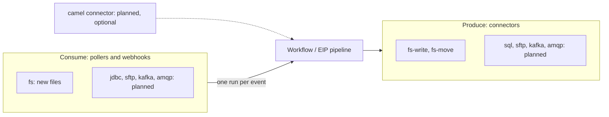

# Endpoints: Wayang as an integration bus (ESB)

Wayang already has the routing and transformation half of an ESB: the EIP pipelines of `docs/EIP.md` cover the Hohpe and Woolf catalog, and Gamelan gives durable execution. What an ESB also needs is **endpoints**: ways to receive from and send to the systems that exist. Rather than re-implement Apache Camel, Wayang adds endpoints as optional extensions and, later, an optional Camel bridge.

## Plan

| Slice | What | Status |
|---|---|---|
| 1 | `wayang-endpoints`: file system connectors and the `fs` trigger source (JDK only) | implemented (this document) |
| 2 | `sql` connector and `jdbc` trigger source over JDBC (driver supplied by the deployment, parameterized queries only) | **proposed** |
| 3 | SFTP/FTP, Kafka and AMQP/JMS as separate optional modules (each needs a client library) | **proposed** |
| 4 | Optional `camel` bridge: call a Camel route or endpoint URI from a step, for teams that already have Camel components (DSL routes, Kamelets) | **proposed**; heavy dependency, never in the core |
| 5 | Releases that serve poll sources from extensions (today a release can run `fs` connectors, but not an `fs` trigger) | **proposed** |

## File endpoints (`wayang-endpoints`)

Feature `ENDPOINTS` (executor type `wayang-endpoints`; in the `integration` and `full` profiles, **not** in `agentic`, so an assistant never gets the file system unless you add it: `WAYANG_PROFILE=agentic,endpoints`). Everything is **off until the operator sets `WAYANG_ENDPOINTS_FS_ROOT`** to a directory.

| Step | Does | Inputs |
|---|---|---|
| `fs-read` | read a file as text (strict UTF-8) or `encoding: base64`; `maxBytes` (default 8 MiB, max 32 MiB) | `path` |
| `fs-write` | atomic write (temp file then move); refuses to replace unless `overwrite: true` | `path`, `content` |
| `fs-list` | files of a directory, `glob` (a file name pattern such as `*.csv`), at most 1000 | `path`, `glob` |
| `fs-move` | move or rename (for example into an archive folder); refuses to replace unless `overwrite` | `from`, `to` |
| `fs-delete` | delete one file, never a directory; already gone is not an error | `path` |

Confinement: each tenant has its own subdirectory under the root (`u-<tenant>`, or `h-<hash>` when the tenant id is not a safe name), so tenants cannot see each other's files. Paths are relative; absolute paths, drive letters, backslashes, NUL, `..` and symbolic links that lead outside the tenant directory are refused. A missing input never fails a run: the step returns `found:false` / `written:false` with a `reason`.

### The `fs` trigger source

A run per new file. Trigger config: `source: fs`, `path` (directory), `glob`, `settleSeconds` (default 2: a file changed more recently is left for the next poll, so a half-written file is never handed over; also write with `fs-write`, which is atomic), `includeExisting` (default false: the first poll ignores the backlog). Events are `{path, name, size, modifiedAt}`; the workflow reads the file with `fs-read` and typically moves it with `fs-move`. The cursor is the last file's (modified time, name): each file is handed over once, in order, at-least-once like every poller; at most 100 events per poll. The trigger service gives pollers the trigger's own tenant, so a trigger can only watch its tenant's directory.

A typical flow: `fs` trigger -> `fs-read` -> EIP pipeline (`parse` csv, `splitter`, `map`, `call`) -> `fs-move` to `archive/`. Failures go to a dead-letter folder with another `fs-move` on the error path (`onError: continue`).

### Limits and verification

- One host directory: a release scales to one replica for file consumption (two replicas would both see the same file); use Gamelan with a single trigger runner, or an atomic claim by `fs-move` into a per-instance folder.
- Network file systems and clock skew can break "settled" detection; raise `settleSeconds`.
- A design-only server (`WAYANG_MODE=design`) refuses triggers like any other.
- Unit-tested (temp directories, symlink, traversal, tenant isolation, atomic write, poller order, settle, cursor). Not run on a network file system or with real inbound traffic.
