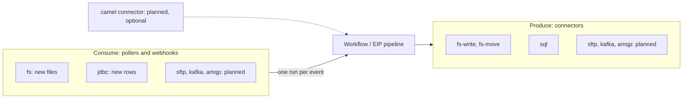

# Endpoints: Wayang as an integration bus (ESB)

Wayang already has the routing and transformation half of an ESB: the EIP pipelines of `docs/EIP.md` cover the Hohpe and Woolf catalog, and Gamelan gives durable execution. What an ESB also needs is **endpoints**: ways to receive from and send to the systems that exist. Rather than re-implement Apache Camel, Wayang adds endpoints as optional extensions and, later, an optional Camel bridge.

## Plan

| Slice | What | Status |
|---|---|---|
| 1 | `wayang-endpoints`: file system connectors and the `fs` trigger source (JDK only) | implemented (this document) |
| 2 | `sql` connector and `jdbc` trigger source over JDBC (driver supplied by the deployment, parameterized queries only) | implemented (below) |
| 3 | SFTP/FTP, Kafka and AMQP/JMS as separate optional modules (each needs a client library) | Kafka **implemented** (`wayang-endpoints-kafka`); SFTP **implemented** (`wayang-endpoints-sftp`); FTP and AMQP/JMS **proposed** |
| 4 | `camel` connector: send a message to an Apache Camel route (DSL, Kamelet) exposed over HTTP; Camel runs in its own process, nothing of Camel is embedded | **implemented** (JDK only; tested against a local HTTP server, never a real Camel runtime) |
| 5 | Releases that serve poll sources from extensions: an `fs` or `jdbc` POLL trigger now generates a release with `wayang-endpoints` and wires `Extensions.load` (tenant `release`) | **implemented** (CI-verified only; not run in a deployed release) |

## File endpoints (`wayang-endpoints`)

Feature `ENDPOINTS` (executor type `wayang-endpoints`; in the `integration` and `full` profiles, **not** in `agentic`, so an assistant never gets the file system unless you add it: `WAYANG_PROFILE=agentic,endpoints`). Everything is **off until the operator sets `WAYANG_ENDPOINTS_FS_ROOT`** to a directory.

| Step | Does | Inputs |
|---|---|---|
| `fs-read` | read a file as text (strict UTF-8) or `encoding: base64`; `maxBytes` (default 8 MiB, max 32 MiB) | `path` |
| `fs-write` | atomic write (temp file then move); refuses to replace unless `overwrite: true` | `path`, `content` |
| `fs-list` | files of a directory, `glob` (a file name pattern such as `*.csv`), at most 1000 | `path`, `glob` |
| `fs-move` | move or rename (for example into an archive folder); refuses to replace unless `overwrite` | `from`, `to` |
| `fs-delete` | delete one file, never a directory; already gone is not an error | `path` |

Confinement: each tenant has its own subdirectory under the root (`u-<tenant>`, or `h-<hash>` when the tenant id is not a safe name), so tenants cannot see each other's files. Paths are relative; absolute paths, drive letters, backslashes, NUL, `..` and symbolic links that lead outside the tenant directory are refused. A missing input never fails a run: the step returns `found:false` / `written:false` with a `reason`.

### The `fs` trigger source

A run per new file. Trigger config: `source: fs`, `path` (directory), `glob`, `settleSeconds` (default 2: a file changed more recently is left for the next poll, so a half-written file is never handed over; also write with `fs-write`, which is atomic), `includeExisting` (default false: the first poll ignores the backlog). Events are `{path, name, size, modifiedAt}`; the workflow reads the file with `fs-read` and typically moves it with `fs-move`. The cursor is the last file's (modified time, name): each file is handed over once, in order, at-least-once like every poller; at most 100 events per poll. The trigger service gives pollers the trigger's own tenant, so a trigger can only watch its tenant's directory.

A typical flow: `fs` trigger -> `fs-read` -> EIP pipeline (`parse` csv, `splitter`, `map`, `call`) -> `fs-move` to `archive/`. Failures go to a dead-letter folder with another `fs-move` on the error path (`onError: continue`).

## SQL endpoints (`sql`, `jdbc`)

Same feature (`ENDPOINTS`). **Off until the operator sets `WAYANG_ENDPOINTS_JDBC_URLS`** to a comma-separated list of permitted `jdbc:` URL prefixes, for example `jdbc:postgresql://db.internal:5432/`. Wayang adds no database library: the deployment puts the JDBC driver on the class path (for a generated release, add the driver dependency to the generated `pom.xml`).

`sql` node config: `url`, `user`, `password` (`${secret:NAME}`), `query`, `mode` (`read` default, or `write`), `maxRows` (default 1000, max 10000), `queryTimeoutSeconds` (default 30, max 300). Input: `params`, the values for the `?` placeholders. Output: `rows` (flat maps, lower-case column names; timestamps as ISO text, binary as base64, long text cut at 64 KiB), `count`, `truncated`; for a write: `updated`.

Why it is safe to expose to workflows and agents:
- The SQL is **node configuration written by the author**. A caller, or a model when `sql` is an agent tool, passes only values, always bound as parameters, never concatenated. A query with a different number of `?` than parameters returns a `reason` instead of running.
- Read-only by default: a single statement that starts with `SELECT` or `WITH`, on a read-only connection. Changing data needs `mode: write` on the node (an author decision; do not expose a write node as an agent tool you do not trust).
- Credentials never go in the URL (a `password=` in it is refused); the URL must match the operator's list.
- Errors show the SQLState (retryable for connection and transaction classes), never the driver's message, which can carry hosts, users or values.
- A `?` inside a string literal in the query counts as a placeholder; use `CHR`/concatenation or a parameter for such text.

`jdbc` trigger source (a run per new row): config `url`, `user`, `password`, `query` with exactly one `?` (the cursor), `cursorColumn` (a result column that only grows), `initialCursor` (required: where to start, so a trigger never replays a whole table), `maxRows` (1-100). Example: `SELECT id, total FROM orders WHERE id > ? ORDER BY id`, `cursorColumn: id`, `initialCursor: 0`. The cursor is bound as a number when it looks like one, otherwise as text; it is always read-only. Delivery is at-least-once, in query order. A trigger sees only what its query selects: give the database user only the rights it needs.

### Limits and verification

- One host directory: a release scales to one replica for file consumption (two replicas would both see the same file); use Gamelan with a single trigger runner, or an atomic claim by `fs-move` into a per-instance folder.
- Network file systems and clock skew can break "settled" detection; raise `settleSeconds`.
- A design-only server (`WAYANG_MODE=design`) refuses triggers like any other.
- Unit-tested (temp directories, symlink, traversal, tenant isolation, atomic write, poller order, settle, cursor). The SQL steps are tested against a fake JDBC driver (statements, binding, read-only enforcement, bounds, hidden errors, cursor): **never run against a real database or driver**. Not run on a network file system or with real inbound traffic.

## Camel bridge (`camel`)

Wayang does not re-implement Camel. Write the integration in Camel's own DSL (YAML, XML or Java route, or a Kamelet binding) and run it with Camel Main, Camel Quarkus, Camel K or JBang, exposing the route over HTTP (`platform-http` or the `rest` DSL). The `camel` step sends it a message and returns the answer.

| Config | Meaning |
|---|---|
| `baseUrl` | http(s) URL of the Camel runtime (required); same SSRF guard as `http`, a private address needs `WAYANG_CONNECTORS_ALLOW_PRIVATE=true` |
| `route` | plain path below `baseUrl`, for example `orders/enrich` (no `..`, query or scheme) |
| `method` | default `POST` |
| `headers` | for example `Authorization: ${secret:CAMEL_TOKEN}` |

Inputs `body` (JSON or text) and `headers` (become Camel message headers). Output and retry rules are those of `http` (5xx, 408, 425 and 429 retry). Limits: request/response over HTTP only; no direct Camel endpoint URIs such as `kafka:` or `sftp:` from Wayang, put those in the Camel route.

## Kafka (`wayang-endpoints-kafka`)

A separate module because it needs `kafka-clients` (version managed by the Quarkus platform BOM); feature `ENDPOINTS_KAFKA` (in `integration` and `full`, not `agentic`). Connector `kafka-publish` and trigger source `kafka`. A release that uses either gets the module (and, through it, kafka-clients).

**Off until the operator permits it**: `WAYANG_ENDPOINTS_KAFKA_SERVERS` (comma-separated `host:port`) and `WAYANG_ENDPOINTS_KAFKA_TOPIC_PREFIXES`. A node can only reach a listed broker and a topic starting with a listed prefix.

| Config | Meaning |
|---|---|
| `bootstrapServers`, `topic` | required; checked against the operator's lists |
| `securityProtocol` | `PLAINTEXT` (default), `SSL`, `SASL_PLAINTEXT`, `SASL_SSL` |
| `saslMechanism`, `saslUsername`, `saslPassword` | `PLAIN` (default), `SCRAM-SHA-256/512`; password as `${secret:NAME}`; never echoed, and characters that could break the JAAS string are refused |
| `startFrom`, `maxRecords` | trigger only: `earliest`/`latest` (required), 1-100 (default 50) |

`kafka-publish`: inputs `value` (text, or object/array as JSON, at most 1 MiB), `key`, `headers` (at most 16); idempotent producer, `acks=all`, waits for the acknowledgement; output `topic`, `partition`, `offset`, `timestamp`. A broker timeout or retriable error is retryable.

`kafka` trigger: Wayang keeps the position, not a consumer group. The cursor is the next offset per partition (`0:120,1:98`), so it is at-least-once, resumes exactly, needs no group coordination and commits nothing on the broker. `latest` pins the end the first time, so records arriving between polls are not missed. If the broker has deleted data the cursor points at, the poll fails with a clear message rather than skipping silently; reset the trigger. Events carry `topic`, `partition`, `offset`, `key`, `value`, `timestamp`, `headers`. Limits: text keys and values only (no Avro or schema registry), one replica should consume a topic, no transactions, no consumer-group scaling.

Verified only against fake clients (no broker): see `KafkaTest`. Never run against a real Kafka.

## SFTP (`wayang-endpoints-sftp`)

A separate module because the JDK has no SSH client: it needs `sshj` (pinned in the module's pom, not managed by the Quarkus BOM). Feature `ENDPOINTS_SFTP` (in `integration` and `full`, not `agentic`). Connectors `sftp-list`, `sftp-read`, `sftp-write`, `sftp-delete` and the `sftp` trigger source. A release that uses any of them gets the module.

**Off until the operator permits it**: `WAYANG_ENDPOINTS_SFTP_HOSTS` (comma-separated `host:port`; a node without `port` means 22). A node can only reach a listed server.

| Config | Meaning |
|---|---|
| `host`, `port`, `user` | the server (must be listed) |
| `password` or `privateKey` (+ `passphrase`) | exactly one; as `${secret:NAME}`; never echoed, error messages carry only the exception type |
| `hostKey` | **mandatory** `SHA256:...` fingerprint of the server (`ssh-keyscan host \| ssh-keygen -lf -`); checked before authenticating; there is no trust-on-first-use and no switch to turn it off |

Paths are relative to the account's home and may not be empty, absolute, contain `..`, empty segments, backslashes or NUL; bad paths are refused before any connection. `sftp-read` returns text (strict UTF-8) or base64, default limit 8 MiB (max 32 MiB); `sftp-write` writes to a temporary name then renames, refusing to replace unless `overwrite`; `sftp-delete` removes one file (never a directory); `sftp-list` lists files (at most 1000). Timeouts and connection failures are retryable, everything else is not.

`sftp` trigger: a run per new file (`path`, `glob`, `settleSeconds` default 5 so a file still being uploaded is not picked up, `includeExisting` default false, `maxFiles` 1-50). Cursor `<mtime>|<name>`: at-least-once, ordered by modification time then name; a file replaced with an older modification time is not seen again. The event holds `name`, `path`, `size`, `mtime`; fetch the content with `sftp-read` and move or delete the file when done. Run it on one replica.

Verified only against a fake session (`SftpTest`); the sshj adapter (`SshjOpener`) compiled on CI at best and has **never talked to a real SFTP server**. FTP/FTPS is not covered.
