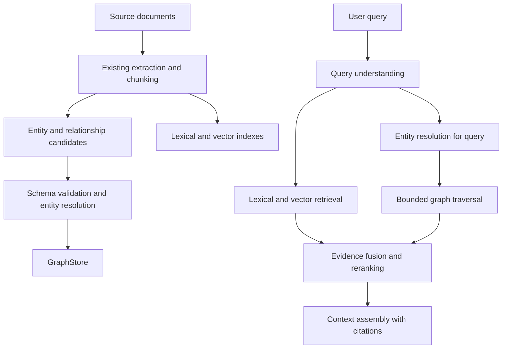

# Knowledge graph and hybrid retrieval

**Status: graph foundation, extraction SPIs, schema validation, conservative alias resolution, evidence lifecycle, PostgreSQL persistence, graph-aware retrieval and the first query-time entity-linking path are implemented.** Workflow nodes and production-grade model-backed query understanding remain planned. This document distinguishes implemented contracts from the intended architecture. A type or SPI is not evidence that a complete graph pipeline exists.

## Goals and non-goals

Wayang's graph capability complements the existing document RAG pipeline; it does not replace it. Existing BM25, vector and hybrid document retrieval must continue to work when graph support is absent.

The graph layer is for relationship-aware knowledge such as:

- organizations, teams, people and ownership;
- policies, versions, applicability and supersession;
- products, components, dependencies and compatibility;
- cases, events, entities and their temporal relationships.

A graph database is not a prerequisite for basic RAG. The public contract is vendor-neutral and must not expose Cypher, Gremlin, SQL or a specific provider's data types.

## Current repository baseline

The current implementation in `wayang-rag` provides bounded document chunking and BM25/vector/hybrid retrieval. `wayang-knowledge` exposes ingestion and search connectors, tenant-scoped named knowledge bases, source persistence and a vector cache. It does not currently contain an entity graph, extraction pipeline, graph persistence adapter or graph-aware retriever.

This first graph slice adds the following JDK-only contracts to `wayang-rag`:

| Contract | Responsibility |
|---|---|
| `KnowledgeEntity` | Canonical entity identity, type, aliases, properties and evidence |
| `KnowledgeRelationship` | Directed typed edge, properties, confidence and evidence |
| `KnowledgeEvidence` | Source/version/chunk and optional character offsets supporting a fact |
| `GraphQuery` | Tenant/collection-scoped traversal with explicit direction, predicates and hard limits |
| `GraphTraversalResult` | Returned entities/edges and a truncation signal |
| `GraphStore` | Provider-neutral persistence/traversal port |
| `InMemoryGraphStore` | Bounded, process-local reference implementation for tests and development |

The reference store validates relationship endpoints, scopes all keys by tenant and collection, and enforces traversal depth/node/edge caps. It is not durable or distributed.

## Architecture



The document and graph paths share source identity, tenant scope, collection identity, access policy and provenance. Graph traversal enriches retrieval with relationships; it must not bypass document ACLs or return evidence the caller cannot access.

## Canonical data model

### Entity

An entity is scoped by `tenantId + collectionId + id`. The caller supplies a stable ID; the core does not guess identity from a display name.

- `type`: controlled entity type such as `Organization`, `Policy` or `Product`.
- `canonicalName` and `aliases`: display and lookup terms, not identity keys.
- `properties`: bounded, non-executable descriptive metadata.
- `evidence`: one or more source references that support the entity.

### Relationship

A relationship is a directed, typed edge with `fromEntityId`, `predicate` and `toEntityId`. Both endpoints must exist in the same tenant and collection before the edge is stored.

Examples of controlled predicates include `OWNS`, `REPORTS_TO`, `APPLIES_TO`, `SUPERSEDES`, `DEPENDS_ON` and `PART_OF`. A future schema registry should define allowed entity and predicate types, cardinality, direction and version. Do not accept arbitrary model-generated predicates without validation.

### Evidence and provenance

Evidence identifies a source document, its version, an optional chunk and optional character offsets in normalized extracted text. Extracted facts should carry evidence. Preserve provenance through deduplication and resolution.

A source deletion or reprocessing must retract only the evidence contributed by that source version. Do not delete a canonical entity or relationship while other valid evidence still supports it. Manually curated facts need an explicit ownership/lifecycle marker before automated cleanup is allowed.

## Extraction and entity resolution pipeline (planned)

1. Consume a normalized document and stable source version from the existing ingestion path.
2. Produce entity and relationship candidates through replaceable extractors.
3. Validate candidate types, predicates, property sizes and evidence offsets against a versioned schema.
4. Resolve aliases and candidate identities within the current tenant and collection.
5. Treat ambiguous matches as reviewable candidates; do not merge entities on fuzzy similarity alone.
6. Upsert entities first, then relationships, preserving all supporting evidence.
7. Record extraction profile/version so documents can be reprocessed deterministically when models or schemas change.

Extractor implementations should be pluggable: deterministic rules, NER libraries or model-backed extractors. A model is optional. Model output is untrusted input and must pass the same schema, scope and size validation as any other extractor.

## Entity and relationship extraction

**Foundation status: implemented in the follow-up extraction SPI.** The extraction API lives in `wayang-rag` and is independent of persistence and model providers.

- `KnowledgeExtractionInput` binds one normalized `Document` and `Chunk` to a tenant, collection and source version. The chunk must belong to the supplied document.
- `EntityExtractor` returns chunk-local `EntityCandidate` mentions.
- `RelationshipExtractor` receives those candidates and returns directed `RelationshipCandidate` edges that reference candidate IDs from the same extraction result.
- `RegexEntityExtractor` and `RegexRelationshipExtractor` provide deterministic, dependency-free implementations for explicitly configured patterns.

Candidate IDs are deterministic for a given tenant, collection, source, source version, chunk, type/predicate and offsets. They are mention identities, not canonical graph entity IDs. The next entity-resolution stage maps mentions to canonical `KnowledgeEntity` records. A changed source version intentionally produces different mention IDs.

Relationship rules bind capture groups to entity candidates at the exact same chunk offsets. If a matching mention is missing or ambiguous, the relationship is skipped rather than guessed. Both extractors have configurable output caps. Regex patterns are trusted application configuration; do not expose arbitrary regular-expression configuration to untrusted users.

A typical composition is:

```java
KnowledgeExtractionInput input = new KnowledgeExtractionInput(
        tenantId, collectionId, sourceVersion, document, chunk);

List<EntityCandidate> entities = entityExtractor.extract(input);
List<RelationshipCandidate> relationships = relationshipExtractor.extract(input, entities);
```

Extraction does not write to `GraphStore`, call a model, make network requests or mutate the source document. Provider-backed extractors can implement the same SPIs, but their output must pass the same validation and scope checks before resolution or persistence.


## Versioned schema validation

**Foundation status: implemented.** `KnowledgeSchema` is an immutable, versioned allow-list of entity types and directed relationship predicates. Each `RelationshipTypeDefinition` declares permitted source and target entity types. A schema rejects relationship definitions that refer to undeclared entity types.

`KnowledgeCandidateValidator` validates extracted candidates before resolution or persistence:

- entity types and relationship predicates must be declared;
- relationship endpoints must refer to unique, valid entity candidate IDs from the same extraction result;
- source and target entity types must satisfy the predicate definition;
- entity and relationship offsets must fit within the normalized source chunk;
- duplicate candidate IDs are rejected.

Validation is deliberately partial: the result contains valid entities/relationships plus machine-readable `KnowledgeValidationIssue` entries. One malformed candidate does not discard unrelated valid candidates. Callers must inspect and record issues; this API does not silently treat rejected candidates as accepted.

The schema is supplied to validation explicitly in this first slice. A persistent/versioned schema registry and migration lifecycle are not included.

## Conservative entity resolution

**Foundation status: implemented.** `EntityResolver` is the provider-neutral resolution SPI. `ExactAliasEntityResolver` is a deterministic reference implementation that matches only exact normalized canonical names or aliases, with the same entity type, within the requested tenant and collection.

Each candidate receives one of three outcomes:

- `MATCHED`: exactly one in-scope canonical entity matched;
- `NEW_ENTITY`: no in-scope canonical entity matched; the caller may propose creation;
- `AMBIGUOUS`: multiple in-scope canonical entities matched and no merge is performed.

The resolver never fuzzy-matches, writes to the graph, creates canonical IDs or crosses tenant/collection boundaries. Other-scope entities are ignored rather than returned as possible matches. Production resolvers may add curated identifiers or human-approved mappings, but must preserve these scope and ambiguity guarantees.


## Canonical graph ingestion and evidence lifecycle

**Foundation status: implemented for the in-memory adapter.** `KnowledgeGraphIngestionService` applies validated chunk candidates and explicit resolution decisions to a `GraphStore`.

- New canonical entity IDs are deterministic hashes of tenant, collection, entity type and normalized name. They are stable across source documents in the same scope; the ID is not derived from display text alone.
- Matched entities must already exist in the requested tenant and collection. An out-of-scope or missing match is reported and not written.
- Ambiguous or missing resolution decisions do not create entities. Relationships whose endpoints were not resolved are skipped with structured issues.
- Relationship IDs are deterministic from scope, canonical endpoints and predicate.
- Each entity/relationship write carries source ID, exact source version, chunk ID, extractor name, offsets and confidence in a `KnowledgeEvidence` record.
- `InMemoryGraphStore` merges aliases and evidence idempotently. Reprocessing the same source version/chunk does not duplicate identical evidence; independent sources accumulate separate evidence records.
- Reusing an entity ID with a different entity type, or a relationship ID with different endpoints/predicate, is rejected as an identity collision.

`GraphStore.retractEvidence(tenantId, collectionId, sourceId, sourceVersion)` removes only evidence for that exact source/version in that exact scope. A relationship is removed only when its last evidence record is removed. Canonical entities are retained even when their evidence list becomes empty; automatic entity deletion is intentionally avoided until curated-vs-extracted ownership and reference semantics are explicit.

For source replacement, the caller should ingest and verify the new source version first, then retract the old version. The current port does not promise a cross-operation transaction, so persistent adapters must define transaction behavior before production use. The in-memory adapter is process-local and does not provide durability or crash atomicity.

The service does not invoke extractors or resolvers itself. The caller supplies validated candidates and resolution decisions, making the boundary explicit and allowing human review for ambiguous candidates. The returned result reports upsert counts, unresolved mentions, skipped relationships and structured issues.

## Graph storage and query

`GraphStore` is the adapter boundary. The initial in-memory implementation is a reference adapter, not a production persistence solution. A persistent provider should be selected only after its transaction, tenant isolation, indexing, migration, backup and operational characteristics are evaluated.

The first query abstraction intentionally supports bounded breadth-first traversal:

- tenant and collection are mandatory;
- callers provide 1–100 seed entity IDs;
- depth is capped at 3;
- nodes are capped at 1,000 and edges at 2,000;
- direction can be outgoing, incoming or both;
- callers may restrict allowed predicates;
- results report when a cap truncates traversal.

Production adapters must enforce the same limits server-side. They must not fetch an unbounded graph and truncate only after materializing it.

## Hybrid retrieval

A graph-aware retrieval pipeline should:

1. retrieve lexical/vector passages using the existing RAG implementation;
2. identify entities mentioned by the retrieved passages and, optionally, the query;
3. traverse only allowed predicates with strict depth and result limits;
4. collect evidence passages supporting each returned edge/entity;
5. apply tenant, collection and source-level authorization before returning any evidence;
6. fuse and rerank graph-derived and document-derived evidence;
7. assemble a bounded context with explicit citations and distinguish direct source statements from derived relationship paths.

Graph results without accessible supporting evidence must not be presented as factual answers. Graph expansion must not be used to bypass the existing untrusted-document warning or agent guardrails.

A future retrieval configuration may expose `mode: vector | keyword | hybrid | graph`, but the existing `bm25 | vector | hybrid` contract must not be silently redefined. Graph retrieval should be additive and explicitly opt-in.

## Wayang workflow integration (planned)

After the graph contracts and lifecycle are stable, expose composable workflow nodes such as:

- `knowledge.extract-entities`
- `knowledge.extract-relationships`
- `knowledge.resolve-entities`
- `knowledge.graph-upsert`
- `knowledge.graph-query`
- `knowledge.graph-neighbors`
- `knowledge.hybrid-retrieve`

Nodes should use the existing advisory mandatory-input convention: missing inputs produce an empty result plus a warning rather than stopping the workflow. The workflow definition owns node wiring; Gamelan owns durable workflow execution. Do not add a competing durable ingestion scheduler to Wayang.

## Security and governance requirements

- Tenant and collection isolation applies to entities, edges, evidence, caches and query results.
- Authorization must be checked on the source evidence, not inferred from graph reachability.
- Bound traversal depth, nodes, edges, candidate counts, property sizes and extraction payloads.
- Restrict predicates and entity types through a versioned schema.
- Keep model-generated text and extracted properties as untrusted data.
- Track extractor/profile version, source version, confidence and provenance for auditability.
- Prevent cross-tenant entity resolution even when names or identifiers match.
- Apply source retention and deletion to evidence; preserve facts only when independent evidence or an explicit curated ownership policy remains.

## Implementation plan and status

| Slice | Scope | Status in this PR |
|---|---|---|
| 1 | Canonical entity, relationship and evidence contracts | Implemented |
| 2 | Vendor-neutral GraphStore SPI and bounded in-memory adapter | Implemented |
| 3 | Entity/relationship extractor SPIs and deterministic regex extractors | Implemented in follow-up PR |
| 4 | Versioned schema model, candidate validation and exact-alias entity resolution | Implemented |
| 5 | In-memory canonical graph upsert, idempotent evidence merge and source-version retraction | Implemented |
| 6 | Persistent schema registry and durable graph/evidence transactions | Planned |
| 7 | Graph-aware retrieval, evidence fusion and citation-preserving context | Planned |
| 8 | Wayang workflow nodes and optional persistent provider | Planned |

Suggested follow-up PRs should remain small and independently testable. The first persistent provider should be chosen after the storage requirements are documented; PostgreSQL relational tables may be a simpler initial option than introducing a graph database, while Neo4j or other graph-native stores can remain optional adapters.

## Acceptance criteria for follow-up work

- Existing RAG tests and behavior remain unchanged when graph support is not configured.
- Entity IDs are stable within a tenant/collection and never globally merged by display name alone.
- Relationships cannot cross tenant or collection boundaries.
- Ambiguous entity matches remain candidates until explicitly resolved.
- Duplicate evidence is idempotent; deleting one source retracts only that source's contribution.
- Traversal limits are enforced by every adapter and truncation is observable.
- Retrieval returns citations for every graph-derived claim and respects source ACLs.
- Malformed or adversarial extractor output is rejected without corrupting the graph.
- The pipeline works with deterministic extractors and no model provider.
- Persistent adapters pass contract tests for isolation, upsert, traversal, failure and restart behavior.

## Verification

This branch adds unit tests for idempotent evidence merge, multi-source provenance, exact source-version retraction, relationship cleanup after the last evidence, ambiguous/missing resolution behavior, and tenant/collection/source/version scoping. Together with the existing graph-store, extraction and schema tests, these tests are authored but have not been executed in this change session. CI must run the module tests and the repository's standard Maven verification before merge.


## Graph-aware retrieval

GraphAwareRetriever is an opt-in composition layer over existing BM25/vector/hybrid document results. It does not change KnowledgeBase.search or RetrievalConfig. Applications may invoke graph expansion with pre-resolved seed IDs or use `retrieveQuery` to compose the configured query mention extractor, scoped graph candidate lookup and entity resolver.

The retrieval sequence is:
1. Run existing document retrieval and retain its Hit list.
2. Resolve query mentions to canonical entity IDs through `QueryEntityLinker` or an application query-understanding layer.
3. Submit bounded traversal limits and optional predicate filters to GraphStore.
4. Collect and deduplicate evidence references from traversed entities and relationships, subject to a maximum evidence count.
5. Resolve references to source passages through GraphEvidenceLookup.
6. Fuse document and graph-derived passage rankings with reciprocal-rank fusion. BM25/vector scores are not compared directly with graph scores.

GraphEvidenceLookup is a security boundary. Each adapter MUST enforce tenant and collection scope, document ACLs, source version and chunk identity before returning a passage. Graph traversal is not authorization. The retriever returns source-backed Hit values, never graph properties or generated graph summaries as standalone factual passages.

Traversal depth, node count, edge count, evidence count and top-K are bounded. Truncation is surfaced in the result. Empty seed sets return the original document hits without invoking graph or evidence lookup.

The query-linking increment provides opt-in regex-based mention extraction, bounded scoped candidate lookup, conservative exact-alias resolution and composition through `GraphAwareRetriever.retrieveQuery`. A model-backed mention extractor, reranking model and graph-native database adapters remain optional future extensions. Existing RAG defaults are unchanged.

## Evidence lookup contract

GraphEvidenceReference carries tenant, collection, entity/relationship identity and exact KnowledgeEvidence provenance. A production lookup should verify that the referenced source version is still current and accessible and that the caller may read the document. If a source was deleted, superseded or access was revoked, the lookup must omit it. Implementations must never widen scope on a failed lookup.

## Limits and compatibility

Existing KnowledgeBase.search and RetrievalConfig APIs are unchanged. The existing GraphQuery traversal bounds remain enforced. Persistent storage and remote evidence lookup implementations can be added behind the existing ports without introducing graph-vendor dependencies into wayang-rag.

## Atomic graph mutations

GraphStore.upsertGraph(entities, relationships) is the atomic ingestion boundary for one chunk mutation:

1. Validate every entity identity and merge rule.
2. Allow relationship endpoints to refer to existing entities or entities in the same batch.
3. Validate relationship identity collisions and capacity constraints.
4. Commit all entity and relationship changes together, or commit none.
5. Merge evidence idempotently.

Persistent adapters must implement this operation with a single database transaction and must not expose partially applied entity/relationship batches. A failed transaction must roll back all rows. Retraction must likewise be transactional within its tenant/collection/source-version scope.

The in-memory adapter stages mutations in private copies and updates its maps only after validation. This provides atomicity within one process, not durability or multi-process coordination.

## Traversal limits

The current query abstraction caps seeds at 100, depth at 3, nodes at 1,000 and edges at 2,000. Implementations must honor these limits and set the result truncation flag when a cap prevents complete traversal. Traversal ordering should be deterministic for equivalent stored data.

## Durable adapter qualification

No database-specific graph provider is included in this phase. The existing wayang-store-jdbc module provides plain-JDBC infrastructure, but selecting it for graph storage requires an explicit schema, transaction and migration design plus integration tests against a supported database. A future provider must qualify:

- tenant/collection isolation in every query and mutation;
- atomic upsertGraph behavior, including injected failures between entity and relationship writes;
- idempotent evidence merge and exact source-version retraction;
- identity collision rejection and endpoint integrity;
- bounded traversal and deterministic truncation;
- process restart durability and concurrent writer behavior;
- schema migration, backup and recovery procedures.

This branch adds unit tests for idempotent evidence merge, multi-source provenance, exact source-version retraction, relationship cleanup after the last evidence, ambiguous/missing resolution behavior, and tenant/collection/source/version scoping. Together with the existing graph-store, extraction and schema tests, these tests are authored but have not been executed in this change session. CI must run the module tests and the repository's standard Maven verification before merge.


## Graph-aware retrieval

GraphAwareRetriever is an opt-in composition layer over existing BM25/vector/hybrid document results. It does not change KnowledgeBase.search or RetrievalConfig. Applications invoke graph expansion only when query understanding supplies tenant- and collection-scoped seed entity IDs.

The retrieval sequence is:
1. Run existing document retrieval and retain its Hit list.
2. Resolve query mentions to canonical entity IDs in the application query-understanding layer.
3. Submit bounded traversal limits and optional predicate filters to GraphStore.
4. Collect and deduplicate evidence references from traversed entities and relationships, subject to a maximum evidence count.
5. Resolve references to source passages through GraphEvidenceLookup.
6. Fuse document and graph-derived passage rankings with reciprocal-rank fusion. BM25/vector scores are not compared directly with graph scores.

GraphEvidenceLookup is a security boundary. Each adapter MUST enforce tenant and collection scope, document ACLs, source version and chunk identity before returning a passage. Graph traversal is not authorization. The retriever returns source-backed Hit values, never graph properties or generated graph summaries as standalone factual passages.

Traversal depth, node count, edge count, evidence count and top-K are bounded. Truncation is surfaced in the result. Empty seed sets return the original document hits without invoking graph or evidence lookup.

The first implementation does not provide automatic query entity linking, a reranking model, graph database adapters, or changes to existing RAG defaults. Applications opt in and supply the query entity IDs and an ACL-aware evidence lookup adapter.

## Evidence lookup contract

GraphEvidenceReference carries tenant, collection, entity/relationship identity and exact KnowledgeEvidence provenance. A production lookup should verify that the referenced source version is still current and accessible and that the caller may read the document. If a source was deleted, superseded or access was revoked, the lookup must omit it. Implementations must never widen scope on a failed lookup.

## Limits and compatibility

Existing KnowledgeBase.search and RetrievalConfig APIs are unchanged. The existing GraphQuery traversal bounds remain enforced. Persistent storage and remote evidence lookup implementations can be added behind the existing ports without introducing graph-vendor dependencies into wayang-rag.

## PostgreSQL JDBC adapter

The durable adapter lives in `wayang-store-jdbc`; the graph contracts in `wayang-rag` remain JDK-only and vendor-neutral. `JdbcGraphStore` currently targets PostgreSQL 16 and uses plain JDBC without bundling a driver.

Apply the idempotent graph schema through `JdbcSchema.apply(dataSource)` or deploy `wayang-store-jdbc/src/main/resources/wayang/schema-knowledge-graph.sql` through the platform's migration process. The schema stores entities, relationships and their evidence in separate tables. Composite keys and foreign keys include both tenant and collection, so relationship endpoints cannot cross either boundary.

`upsertGraph` runs in one JDBC transaction. It validates endpoint existence and immutable identity fields, merges aliases/properties and inserts evidence idempotently. A failure rolls back the entire entity/relationship batch. Source-version retraction also runs transactionally: it deletes only evidence for the exact tenant, collection, source and version, then removes only relationships that lost their final evidence in that operation. Entities are retained, and relationships without evidence (for example curated edges) are not removed by unrelated source retractions.

Traversal performs bounded breadth-first reads with deterministic relationship ordering and the limits carried by `GraphQuery`. It queries adjacency by indexed endpoint columns and never exposes SQL to the RAG contract. Authorization of source passages remains the responsibility of the graph evidence lookup / document retrieval adapter.

The optional integration test `JdbcGraphStoreIT` runs when `WAYANG_TEST_JDBC_URL` is configured and a PostgreSQL JDBC driver is present on the test classpath. It covers persistence across adapter instances, tenant isolation, batch rollback, exact-version evidence retraction and preservation of curated relationships. Without that environment variable the test returns without contacting a database; a green CI run alone therefore does not prove PostgreSQL integration behavior.


## Query-time entity linking (Phase 11 increment)

**Implemented contract and reference path:** `QueryMentionExtractor` extracts query-local mentions; `RegexQueryMentionExtractor` is a deterministic, dependency-free implementation for trusted configured patterns. `GraphEntityLookup` returns a bounded candidate set within an explicit tenant and collection. `QueryEntityLinker` delegates canonical resolution to the existing `EntityResolver` SPI and accepts only one decision per mention. A match is accepted only when the canonical entity is in the returned scoped candidate set. Ambiguous mentions produce no seed IDs; new/unmatched mentions do not trigger graph expansion.

`InMemoryGraphStore` implements the lookup port for development and tests. `JdbcGraphEntityLookup` provides a PostgreSQL candidate adapter using tenant, collection and entity-type predicates with a hard result limit; it hydrates candidates through `GraphStore.findEntity`. The exact-alias resolver remains provider-neutral and performs final name/alias comparison in Java.

`GraphAwareRetriever.retrieveQuery` composes query linking with the existing graph-aware retrieval path and returns `QueryGraphRetrievalResult`, preserving both linking diagnostics and retrieval output. When no mentions match (or all mentions are ambiguous/new), the resolved seed set is empty and document-only hits are retained without graph/evidence lookup. Existing `KnowledgeBase.search` and retrieval defaults remain unchanged.

The first regex mention extractor is deliberately configuration-driven; it is not a general-purpose NER model. Candidate lookup is capped at 2,000 entities and query extraction at 100 mentions. Applications should configure entity-type patterns conservatively. A future provider may implement a more selective indexed name/alias lookup without changing the SPI. The evidence lookup remains responsible for source ACL/current-version checks; entity linking does not grant document access.

**Verification status:** tests cover exact in-scope matching, ambiguous aliases, lookup scope enforcement, document-only fallback and linking-to-retrieval composition. Tests are authored but have not been executed in this session. CI must validate both `wayang-rag` and `wayang-store-jdbc`, including the PostgreSQL integration test.

## Model-assisted query entity linking (Phase 12 increment)

`ModelQueryMentionExtractor` adapts an injected `QueryMentionModel` without adding a model SDK or provider dependency to `wayang-rag`. Every returned span is checked against the original query text, offsets, entity-type and surface-length bounds, and a configurable minimum confidence. Malformed, low-confidence, empty or failed model output falls back to the configured deterministic `QueryMentionExtractor`. Query length remains capped at 2,000 characters and mention count at 100.

`ConfidenceAwareEntityResolver` adapts an injected `EntityResolutionModel` over the already bounded tenant/collection candidate set. It accepts a model match only when both the absolute confidence threshold and winner-to-runner-up margin pass, and the selected entity ID and entity type belong to the supplied candidate set. Low-confidence or ambiguous predictions fall back to `ExactAliasEntityResolver`; provider failures and malformed/out-of-scope responses fall back for the full request. Neither model output nor entity linking can widen tenant/collection scope or bypass the ACL-aware evidence lookup.

Both model ports are synchronous, provider-neutral SPIs. Applications own timeout, retry, concurrency and provider lifecycle policy in their adapter layer. Deterministic implementations remain available and are suitable for offline tests and deployments without a model provider.


## Query understanding evaluation

The model-assisted extraction path now has a deterministic golden-set regression harness covering exact span/type precision, recall and F1, including missed and extra mentions. See [Query understanding evaluation](QUERY-UNDERSTANDING-EVALUATION.md) for scope, invocation and limitations. The fixture uses a synthetic provider; its metrics validate the harness, not real model quality. Provider benchmarking requires a separately versioned representative dataset and the actual adapter.
