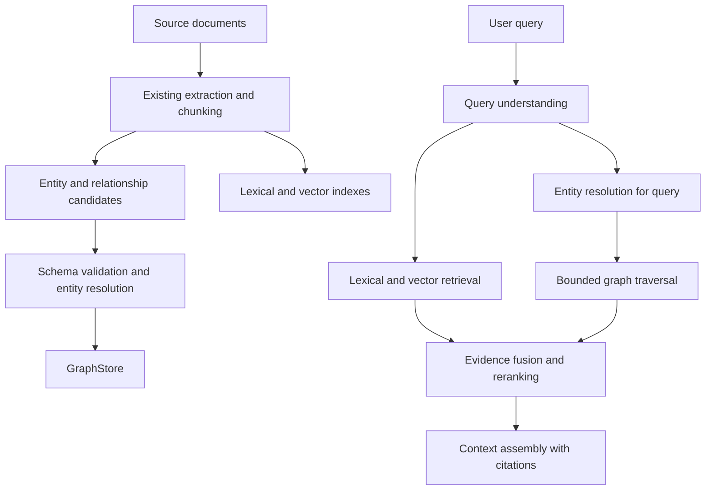

# Knowledge graph and hybrid retrieval

**Status: graph foundation, extraction SPIs, schema validation, conservative alias resolution and an in-memory evidence lifecycle are implemented.** Durable persistence, workflow nodes and graph-aware retrieval remain planned. This document distinguishes implemented contracts from the intended architecture. A type or SPI is not evidence that a complete graph pipeline exists.

## Goals and non-goals

Wayang's graph capability complements the existing document RAG pipeline; it does not replace it. Existing BM25, vector and hybrid document retrieval must continue to work when graph support is absent.

The graph layer is for relationship-aware knowledge such as:

- organizations, teams, people and ownership;
- policies, versions, applicability and supersession;
- products, components, dependencies and compatibility;
- cases, events, entities and their temporal relationships.

A graph database is not a prerequisite for basic RAG. The public contract is vendor-neutral and must not expose Cypher, Gremlin, SQL or a specific provider's data types.

## Current repository baseline

The current implementation in `wayang-rag` provides bounded document chunking and BM25/vector/hybrid retrieval. `wayang-knowledge` exposes ingestion and search connectors, tenant-scoped named knowledge bases, source persistence and a vector cache. It does not currently contain an entity graph, extraction pipeline, graph persistence adapter or graph-aware retriever.

This first graph slice adds the following JDK-only contracts to `wayang-rag`:

| Contract | Responsibility |
|---|---|
| `KnowledgeEntity` | Canonical entity identity, type, aliases, properties and evidence |
| `KnowledgeRelationship` | Directed typed edge, properties, confidence and evidence |
| `KnowledgeEvidence` | Source/version/chunk and optional character offsets supporting a fact |
| `GraphQuery` | Tenant/collection-scoped traversal with explicit direction, predicates and hard limits |
| `GraphTraversalResult` | Returned entities/edges and a truncation signal |
| `GraphStore` | Provider-neutral persistence/traversal port |
| `InMemoryGraphStore` | Bounded, process-local reference implementation for tests and development |

The reference store validates relationship endpoints, scopes all keys by tenant and collection, and enforces traversal depth/node/edge caps. It is not durable or distributed.

## Architecture



The document and graph paths share source identity, tenant scope, collection identity, access policy and provenance. Graph traversal enriches retrieval with relationships; it must not bypass document ACLs or return evidence the caller cannot access.

## Canonical data model

### Entity

An entity is scoped by `tenantId + collectionId + id`. The caller supplies a stable ID; the core does not guess identity from a display name.

- `type`: controlled entity type such as `Organization`, `Policy` or `Product`.
- `canonicalName` and `aliases`: display and lookup terms, not identity keys.
- `properties`: bounded, non-executable descriptive metadata.
- `evidence`: one or more source references that support the entity.

### Relationship

A relationship is a directed, typed edge with `fromEntityId`, `predicate` and `toEntityId`. Both endpoints must exist in the same tenant and collection before the edge is stored.

Examples of controlled predicates include `OWNS`, `REPORTS_TO`, `APPLIES_TO`, `SUPERSEDES`, `DEPENDS_ON` and `PART_OF`. A future schema registry should define allowed entity and predicate types, cardinality, direction and version. Do not accept arbitrary model-generated predicates without validation.

### Evidence and provenance

Evidence identifies a source document, its version, an optional chunk and optional character offsets in normalized extracted text. Extracted facts should carry evidence. Preserve provenance through deduplication and resolution.

A source deletion or reprocessing must retract only the evidence contributed by that source version. Do not delete a canonical entity or relationship while other valid evidence still supports it. Manually curated facts need an explicit ownership/lifecycle marker before automated cleanup is allowed.

## Extraction and entity resolution pipeline (planned)

1. Consume a normalized document and stable source version from the existing ingestion path.
2. Produce entity and relationship candidates through replaceable extractors.
3. Validate candidate types, predicates, property sizes and evidence offsets against a versioned schema.
4. Resolve aliases and candidate identities within the current tenant and collection.
5. Treat ambiguous matches as reviewable candidates; do not merge entities on fuzzy similarity alone.
6. Upsert entities first, then relationships, preserving all supporting evidence.
7. Record extraction profile/version so documents can be reprocessed deterministically when models or schemas change.

Extractor implementations should be pluggable: deterministic rules, NER libraries or model-backed extractors. A model is optional. Model output is untrusted input and must pass the same schema, scope and size validation as any other extractor.

## Entity and relationship extraction

**Foundation status: implemented in the follow-up extraction SPI.** The extraction API lives in `wayang-rag` and is independent of persistence and model providers.

- `KnowledgeExtractionInput` binds one normalized `Document` and `Chunk` to a tenant, collection and source version. The chunk must belong to the supplied document.
- `EntityExtractor` returns chunk-local `EntityCandidate` mentions.
- `RelationshipExtractor` receives those candidates and returns directed `RelationshipCandidate` edges that reference candidate IDs from the same extraction result.
- `RegexEntityExtractor` and `RegexRelationshipExtractor` provide deterministic, dependency-free implementations for explicitly configured patterns.

Candidate IDs are deterministic for a given tenant, collection, source, source version, chunk, type/predicate and offsets. They are mention identities, not canonical graph entity IDs. The next entity-resolution stage maps mentions to canonical `KnowledgeEntity` records. A changed source version intentionally produces different mention IDs.

Relationship rules bind capture groups to entity candidates at the exact same chunk offsets. If a matching mention is missing or ambiguous, the relationship is skipped rather than guessed. Both extractors have configurable output caps. Regex patterns are trusted application configuration; do not expose arbitrary regular-expression configuration to untrusted users.

A typical composition is:

```java
KnowledgeExtractionInput input = new KnowledgeExtractionInput(
        tenantId, collectionId, sourceVersion, document, chunk);

List<EntityCandidate> entities = entityExtractor.extract(input);
List<RelationshipCandidate> relationships = relationshipExtractor.extract(input, entities);
```

Extraction does not write to `GraphStore`, call a model, make network requests or mutate the source document. Provider-backed extractors can implement the same SPIs, but their output must pass the same validation and scope checks before resolution or persistence.


## Versioned schema validation

**Foundation status: implemented.** `KnowledgeSchema` is an immutable, versioned allow-list of entity types and directed relationship predicates. Each `RelationshipTypeDefinition` declares permitted source and target entity types. A schema rejects relationship definitions that refer to undeclared entity types.

`KnowledgeCandidateValidator` validates extracted candidates before resolution or persistence:

- entity types and relationship predicates must be declared;
- relationship endpoints must refer to unique, valid entity candidate IDs from the same extraction result;
- source and target entity types must satisfy the predicate definition;
- entity and relationship offsets must fit within the normalized source chunk;
- duplicate candidate IDs are rejected.

Validation is deliberately partial: the result contains valid entities/relationships plus machine-readable `KnowledgeValidationIssue` entries. One malformed candidate does not discard unrelated valid candidates. Callers must inspect and record issues; this API does not silently treat rejected candidates as accepted.

The schema is supplied to validation explicitly in this first slice. A persistent/versioned schema registry and migration lifecycle are not included.

## Conservative entity resolution

**Foundation status: implemented.** `EntityResolver` is the provider-neutral resolution SPI. `ExactAliasEntityResolver` is a deterministic reference implementation that matches only exact normalized canonical names or aliases, with the same entity type, within the requested tenant and collection.

Each candidate receives one of three outcomes:

- `MATCHED`: exactly one in-scope canonical entity matched;
- `NEW_ENTITY`: no in-scope canonical entity matched; the caller may propose creation;
- `AMBIGUOUS`: multiple in-scope canonical entities matched and no merge is performed.

The resolver never fuzzy-matches, writes to the graph, creates canonical IDs or crosses tenant/collection boundaries. Other-scope entities are ignored rather than returned as possible matches. Production resolvers may add curated identifiers or human-approved mappings, but must preserve these scope and ambiguity guarantees.


## Canonical graph ingestion and evidence lifecycle

**Foundation status: implemented for the in-memory adapter.** `KnowledgeGraphIngestionService` applies validated chunk candidates and explicit resolution decisions to a `GraphStore`.

- New canonical entity IDs are deterministic hashes of tenant, collection, entity type and normalized name. They are stable across source documents in the same scope; the ID is not derived from display text alone.
- Matched entities must already exist in the requested tenant and collection. An out-of-scope or missing match is reported and not written.
- Ambiguous or missing resolution decisions do not create entities. Relationships whose endpoints were not resolved are skipped with structured issues.
- Relationship IDs are deterministic from scope, canonical endpoints and predicate.
- Each entity/relationship write carries source ID, exact source version, chunk ID, extractor name, offsets and confidence in a `KnowledgeEvidence` record.
- `InMemoryGraphStore` merges aliases and evidence idempotently. Reprocessing the same source version/chunk does not duplicate identical evidence; independent sources accumulate separate evidence records.
- Reusing an entity ID with a different entity type, or a relationship ID with different endpoints/predicate, is rejected as an identity collision.

`GraphStore.retractEvidence(tenantId, collectionId, sourceId, sourceVersion)` removes only evidence for that exact source/version in that exact scope. A relationship is removed only when its last evidence record is removed. Canonical entities are retained even when their evidence list becomes empty; automatic entity deletion is intentionally avoided until curated-vs-extracted ownership and reference semantics are explicit.

For source replacement, the caller should ingest and verify the new source version first, then retract the old version. The current port does not promise a cross-operation transaction, so persistent adapters must define transaction behavior before production use. The in-memory adapter is process-local and does not provide durability or crash atomicity.

The service does not invoke extractors or resolvers itself. The caller supplies validated candidates and resolution decisions, making the boundary explicit and allowing human review for ambiguous candidates. The returned result reports upsert counts, unresolved mentions, skipped relationships and structured issues.

## Graph storage and query

`GraphStore` is the adapter boundary. The initial in-memory implementation is a reference adapter, not a production persistence solution. A persistent provider should be selected only after its transaction, tenant isolation, indexing, migration, backup and operational characteristics are evaluated.

The first query abstraction intentionally supports bounded breadth-first traversal:

- tenant and collection are mandatory;
- callers provide 1–100 seed entity IDs;
- depth is capped at 3;
- nodes are capped at 1,000 and edges at 2,000;
- direction can be outgoing, incoming or both;
- callers may restrict allowed predicates;
- results report when a cap truncates traversal.

Production adapters must enforce the same limits server-side. They must not fetch an unbounded graph and truncate only after materializing it.

## Hybrid retrieval (planned)

A graph-aware retrieval pipeline should:

1. retrieve lexical/vector passages using the existing RAG implementation;
2. identify entities mentioned by the retrieved passages and, optionally, the query;
3. traverse only allowed predicates with strict depth and result limits;
4. collect evidence passages supporting each returned edge/entity;
5. apply tenant, collection and source-level authorization before returning any evidence;
6. fuse and rerank graph-derived and document-derived evidence;
7. assemble a bounded context with explicit citations and distinguish direct source statements from derived relationship paths.

Graph results without accessible supporting evidence must not be presented as factual answers. Graph expansion must not be used to bypass the existing untrusted-document warning or agent guardrails.

A future retrieval configuration may expose `mode: vector | keyword | hybrid | graph`, but the existing `bm25 | vector | hybrid` contract must not be silently redefined. Graph retrieval should be additive and explicitly opt-in.

## Wayang workflow integration (planned)

After the graph contracts and lifecycle are stable, expose composable workflow nodes such as:

- `knowledge.extract-entities`
- `knowledge.extract-relationships`
- `knowledge.resolve-entities`
- `knowledge.graph-upsert`
- `knowledge.graph-query`
- `knowledge.graph-neighbors`
- `knowledge.hybrid-retrieve`

Nodes should use the existing advisory mandatory-input convention: missing inputs produce an empty result plus a warning rather than stopping the workflow. The workflow definition owns node wiring; Gamelan owns durable workflow execution. Do not add a competing durable ingestion scheduler to Wayang.

## Security and governance requirements

- Tenant and collection isolation applies to entities, edges, evidence, caches and query results.
- Authorization must be checked on the source evidence, not inferred from graph reachability.
- Bound traversal depth, nodes, edges, candidate counts, property sizes and extraction payloads.
- Restrict predicates and entity types through a versioned schema.
- Keep model-generated text and extracted properties as untrusted data.
- Track extractor/profile version, source version, confidence and provenance for auditability.
- Prevent cross-tenant entity resolution even when names or identifiers match.
- Apply source retention and deletion to evidence; preserve facts only when independent evidence or an explicit curated ownership policy remains.

## Implementation plan and status

| Slice | Scope | Status in this PR |
|---|---|---|
| 1 | Canonical entity, relationship and evidence contracts | Implemented |
| 2 | Vendor-neutral GraphStore SPI and bounded in-memory adapter | Implemented |
| 3 | Entity/relationship extractor SPIs and deterministic regex extractors | Implemented in follow-up PR |
| 4 | Versioned schema model, candidate validation and exact-alias entity resolution | Implemented |
| 5 | In-memory canonical graph upsert, idempotent evidence merge and source-version retraction | Implemented |
| 6 | Persistent schema registry and durable graph/evidence transactions | Planned |
| 7 | Graph-aware retrieval, evidence fusion and citation-preserving context | Planned |
| 8 | Wayang workflow nodes and optional persistent provider | Planned |

Suggested follow-up PRs should remain small and independently testable. The first persistent provider should be chosen after the storage requirements are documented; PostgreSQL relational tables may be a simpler initial option than introducing a graph database, while Neo4j or other graph-native stores can remain optional adapters.

## Acceptance criteria for follow-up work

- Existing RAG tests and behavior remain unchanged when graph support is not configured.
- Entity IDs are stable within a tenant/collection and never globally merged by display name alone.
- Relationships cannot cross tenant or collection boundaries.
- Ambiguous entity matches remain candidates until explicitly resolved.
- Duplicate evidence is idempotent; deleting one source retracts only that source's contribution.
- Traversal limits are enforced by every adapter and truncation is observable.
- Retrieval returns citations for every graph-derived claim and respects source ACLs.
- Malformed or adversarial extractor output is rejected without corrupting the graph.
- The pipeline works with deterministic extractors and no model provider.
- Persistent adapters pass contract tests for isolation, upsert, traversal, failure and restart behavior.

## Verification

This branch adds unit tests for idempotent evidence merge, multi-source provenance, exact source-version retraction, relationship cleanup after the last evidence, ambiguous/missing resolution behavior, and tenant/collection/source/version scoping. Together with the existing graph-store, extraction and schema tests, these tests are authored but have not been executed in this change session. CI must run the module tests and the repository's standard Maven verification before merge.
