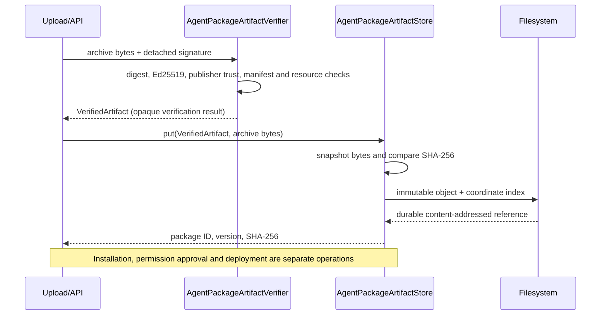

# Agent Package Artifact Repository

> Status: M1.9 local filesystem implementation. This is an artifact byte store and immutable package-coordinate index, not a marketplace, installer, permission grant service, or deployment controller.

## Responsibilities and boundaries

The repository stores an Agent Package archive only after AgentPackageArtifactVerifier has accepted the archive and publisher signature. The store independently snapshots and hashes the supplied bytes and requires the digest to equal the verifier-produced VerifiedArtifact.archiveSha256() value.

- AgentPackageArtifactStore is the storage contract.
- FileSystemAgentPackageArtifactStore is the initial local backend.
- Objects are addressed by the full SHA-256 digest.
- (packageId, version) coordinates are immutable and map to exactly one digest.
- Duplicate upload of the same bytes and coordinate is idempotent.
- Reusing a coordinate for different bytes is rejected.
- Reads re-hash the bytes and fail closed on corruption.
- Package IDs and versions never become filesystem path segments; the coordinate index filename is a SHA-256 hash of the coordinate.
- Writes use bounded input, same-directory temporary files, forced file contents and atomic moves. The repository filesystem must support atomic moves.

The configured repository root must be writable only by the Wayang service account. Tenant/project authorization belongs to the API/catalog boundary and must be checked before exposing artifact references or bytes. A content digest is an integrity address, not an authorization token or trust proof.

## Layout

```text
WAYANG_AGENT_ARTIFACTS_DIR/
  objects/
    ab/
      ab...<64-hex-sha256>.zip
  coordinates/
    <sha256(packageId + newline + version)>.ref
  locks/
    <sha256(packageId + newline + version)>.lock
```

The coordinate index contains the full lowercase SHA-256 digest. Object retrieval verifies that the stored bytes still hash to that digest. The lock file serializes concurrent writers for a coordinate across processes; a competing writer receives a retryable conflict rather than silently rebinding the version.

## Configuration

- WAYANG_AGENT_ARTIFACTS_DIR: explicit repository root.
- WAYANG_STATE_DIR: fallback root, with artifacts stored under agent-artifacts.
- If neither is configured, fromEnvironment() returns null; the application must report missing configuration rather than silently use temporary storage.
- Maximum archive size: 64 MiB, aligned with the current verifier limit.

## Flow



## Deliberate limitations

- No HTTP upload/download endpoints, marketplace catalog, publisher self-service, search, ranking, or package listing API.
- No S3-compatible backend yet; the interface is the extension point for one.
- No package deletion or garbage collection yet. Retention and deletion require reference accounting across installed locks, release locks and catalog versions; deleting by digest without that accounting would break reproducible installs.
- No raw/unverified staging area. Only verifier-produced artifacts can enter through the public put contract.
- The repository does not persist verification receipts or re-evaluate current publisher revocation on every read. Verification is performed before storage; operators must define a separate re-verification/revocation policy before deployment.
- Artifact bytes are not tenant-isolated at the storage layer. Authorization must be enforced by the future API/catalog layer; storage must not be exposed directly to clients.
- Filesystem atomic-move support is required. Use a durable mounted volume in container deployments; do not use ephemeral container storage for production packages.

## Next increments

1. Add a database-backed coordinate/catalog index and retention reference accounting.
2. Add an S3-compatible object-store adapter without changing the domain contract.
3. Add authorized upload/download API and quarantine/verification workflow.
4. Add marketplace publication, discovery and moderation lifecycle.
