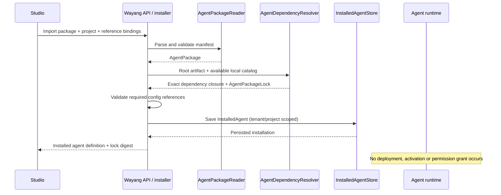

# Agent Package Installation and Locking

> Status: **implemented domain and persistence primitives; no marketplace or runtime activation**. This document describes the M1.7 implementation. It does not claim a package registry, remote download, signature verification, dynamic code loading, Studio import UI, REST endpoints, or agent deployment.

## 1. Purpose and lifecycle boundary

An Agent Package is a portable, versioned agent definition. Installing it creates a project-scoped reference to an immutable package artifact and a deterministic dependency lock.

Installation is not deployment:

- **Read/validate:** parse a manifest and map its embedded definition to the existing `AgentSpec`.
- **Resolve/lock:** resolve the package's supported agent dependency closure and pin exact versions and SHA-256 artifact digests.
- **Install:** validate configuration references and persist a project-scoped `InstalledAgent`.
- **Deploy/activate:** a separate future operation that packages or deploys an agent runtime. Installation does not start an agent or grant requested permissions.

## 2. Flow

The installer is transport-neutral. A REST resource or Studio flow must authorize the caller against the target project before invoking the store.

## 3. Lock contract

`AgentPackageLock` pins:

- Root package ID and exact SemVer version.
- Root artifact SHA-256 digest.
- Every resolved agent dependency's kind, ID, exact version and artifact SHA-256 digest.
- A SHA-256 digest over a canonical, sorted representation of the lock contents.

The lock is deterministic regardless of dependency declaration or catalog iteration order. A lock digest is an integrity identifier for the lock document; it is not a signature and does not prove who published the artifact.

The resolver accepts an explicit catalog of artifacts already available to the caller. It performs no network access and does not fetch missing dependencies. It chooses the highest compatible available version, resolves transitively, detects cycles, and rejects missing required dependencies or incompatible constraints.

### Current resolver scope

- Required and optional `agent` dependencies are supported.
- Missing optional dependencies are omitted.
- Required dependencies of other kinds (for example `extension`, `skill`, or `workflow-template`) fail with an explicit unsupported-kind error. Optional non-agent dependencies are skipped.
- Supported ranges: exact SemVer, `*`, `^`, `~`, and numeric comparator conjunctions. This is a deliberately bounded resolver, not a complete npm/Maven version-range implementation.

## 4. Project installation record

`InstalledAgent` is scoped by the tuple:

`(tenantId, projectId, installationId)`

It stores the exact package lock, requested permissions, timestamps, and configuration bindings. The installation ID is the project's local handle; it is distinct from the publisher's package ID.

Configuration binding values are references only:

- `secret-reference` uses `secret://...`
- `connection-reference` uses `connection://...`
- `value` uses `config://...`

Literal secret values and connection credentials are not accepted by the binding model. Requested permissions remain requests; installation does not turn them into grants.

Persistence contracts:

- `InstalledAgentStore.InMemory` supports local/test use.
- `JdbcInstalledAgentStore` stores records in `wayang_installed_agent`, keyed by tenant, project and installation.
- JDBC upserts reject stale updates using the persisted update timestamp.

The store is deliberately separate from `ProjectStore`: project metadata and installed agent inventory have different lifecycles. Store methods do not replace project authorization checks.

## 5. Upgrade preview and rollback metadata

`AgentUpgradePlanner.preview(current, target)` is non-mutating. It requires the same tenant, project, installation ID and package identity, then reports:

- Root package version change.
- Added, upgraded and removed dependency pins.
- The prior exact lock as `rollbackLock`.

This PR does not execute upgrades or rollbacks, migrate configuration, deploy new runtime instances, or guarantee compatibility of an agent's external side effects. Those actions require a separate approval and deployment lifecycle.

## 6. Security and trust boundaries

The M1.7 implementation does not yet:

- Verify archive bytes against the supplied SHA-256 digest. The digest is treated as caller-provided artifact metadata and is pinned into the lock.
- Verify publisher signatures, provenance, SBOM, revocation or trust policy.
- Download packages or resolve dependencies from a remote marketplace.
- Grant permissions, resolve credentials, or execute package code.
- Dynamically activate or hot-load an installed package.
- Deploy, start, stop or roll back a running agent service.

Before a package can be activated in a production runtime, a future trust gate must verify immutable artifact bytes, signatures and publisher identity, compatibility, dependency closure, policy approval and runtime isolation. Untrusted executable extensions must not be loaded into Studio or core in-process.

## 7. Verification status

The implementation adds unit tests for deterministic lock generation, dependency closure, version selection, missing and optional dependencies, cycles, unsupported dependency kinds, configuration-reference validation, project/tenant store isolation, stale updates, upgrade preview and rollback-lock retention.

JDBC persistence is implemented against the repository's PostgreSQL-oriented schema. A passing database integration test is still required before claiming end-to-end JDBC verification. CI results for the pull request are the authoritative build evidence.
