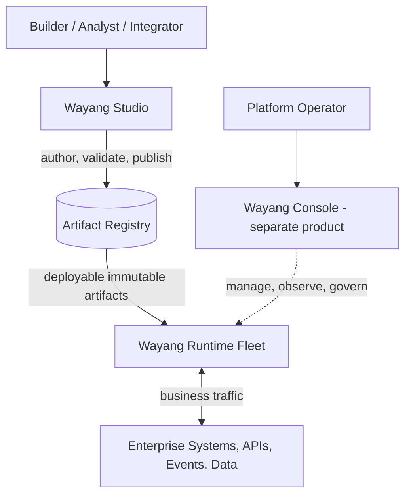
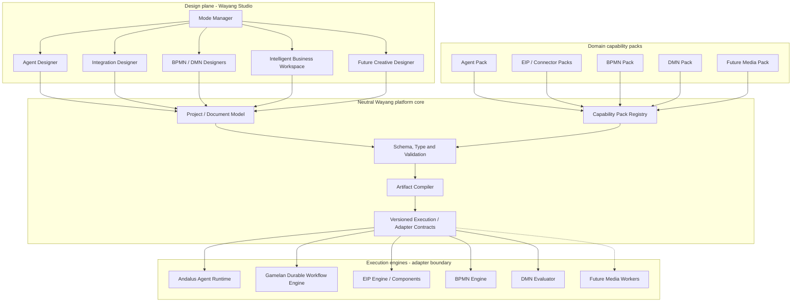
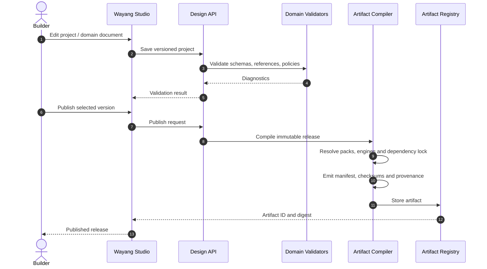
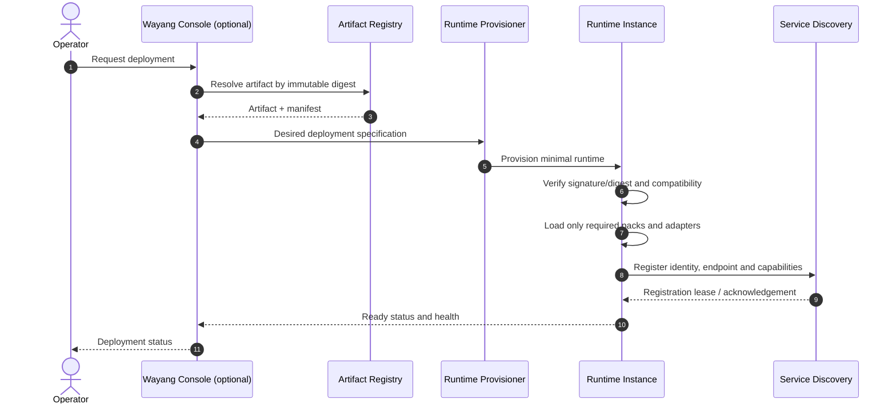
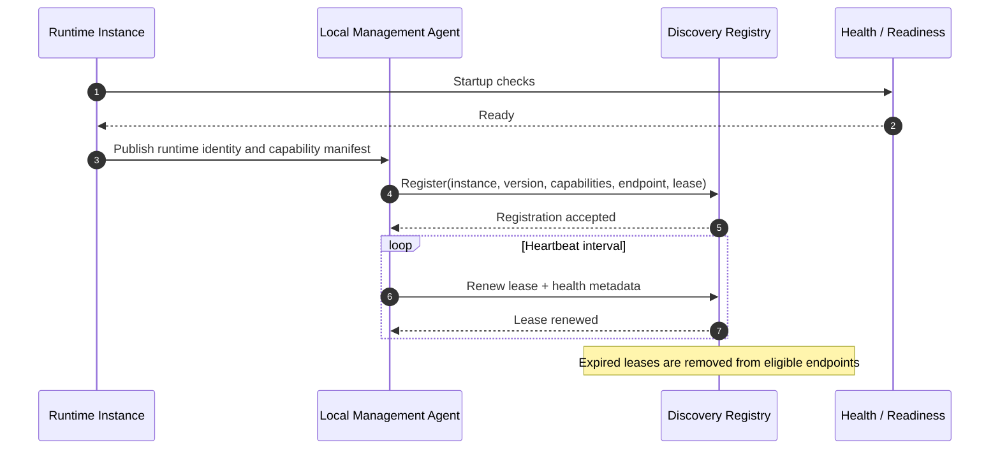
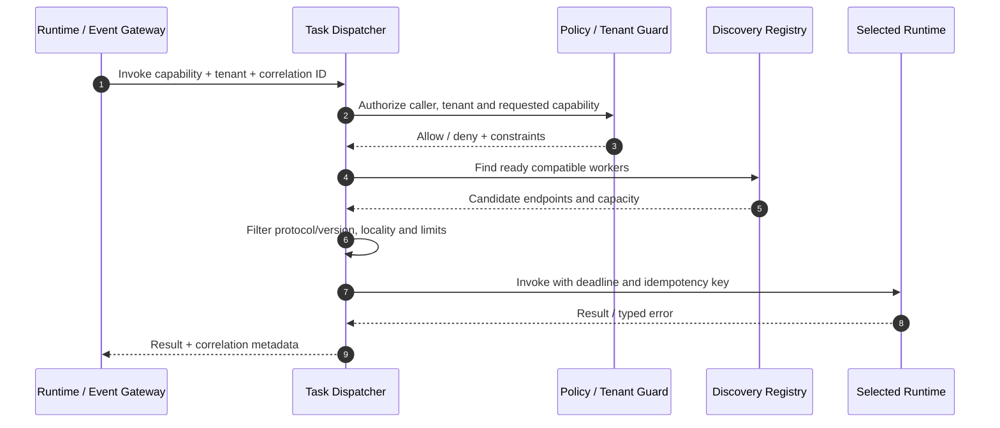
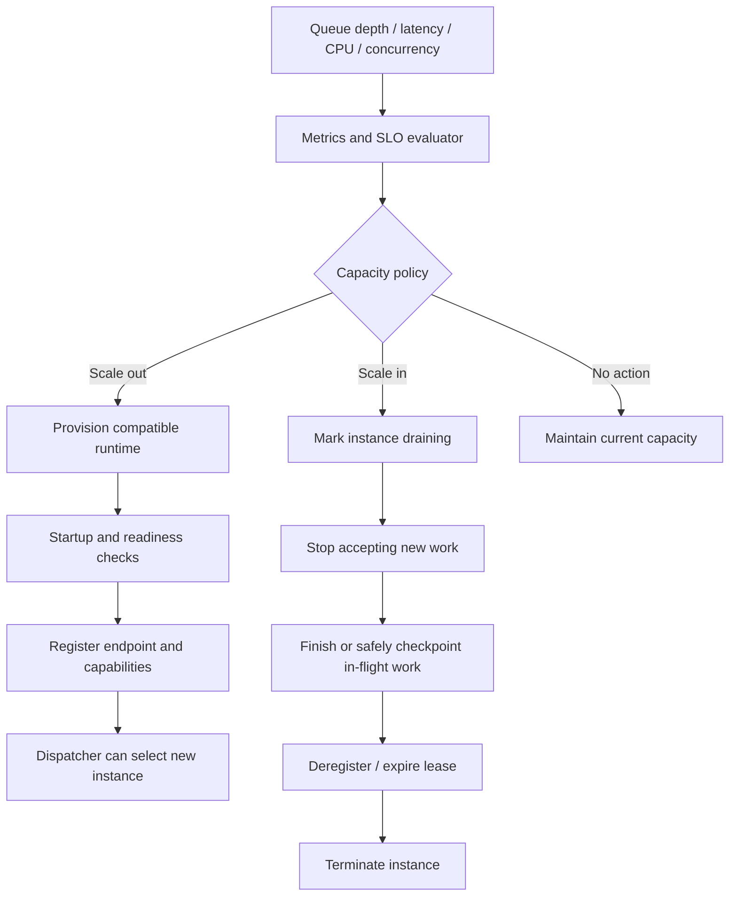
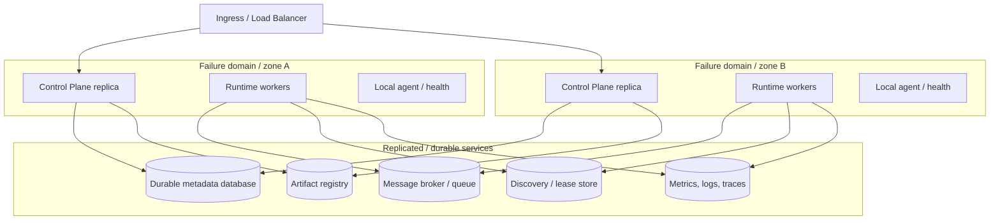

# Wayang Platform Architecture Diagrams

> These diagrams describe the target architecture. A diagram is not evidence that every depicted component is implemented. Consult [current implementation architecture](../ARCHITECTURE.md), [editions and deployment status](../EDITIONS.md), and the mode-specific documents in this directory.

## 1. System context



The Console is a separate product/repository. Runtime business execution must not synchronously depend on Studio, Console, or the artifact registry after deployment.

## 2. Platform logical architecture



## 3. Authoring-to-artifact sequence



Compiler requirements: deterministic resolution; pinned versions; compatibility checks; software bill of materials where applicable; signed provenance where enabled; no embedded secret values; configuration and secret references only.

## 4. Runtime deployment sequence



For Community, the integrated runtime starts locally without Console or service discovery. For Pro, a generated runtime may be started independently. Enterprise adds fleet management and distributed placement. The exact automation of these steps is implementation-dependent.

## 5. Runtime registration and capability discovery



Discovery records should include runtime ID, tenant/security scope, deployment and artifact version, supported adapter/component capabilities, protocol/API version, endpoint, region/zone, capacity/load, readiness, lease expiry and drain state. Do not expose secrets in discovery metadata.

## 6. Capability-aware dispatch sequence



Routing policy can consider capability match, tenant placement, region/data residency, priority, concurrency limits and observed load. Do not route based on load before enforcing authorization and compatibility.

## 7. Scale-out and scale-in



Scale-in must not kill active work. Long-running executions need engine-owned checkpoint/resume or a safe drain timeout and recovery policy. Queue depth and latency are often more useful than CPU alone for worker scaling.

## 8. Failure detection and recovery

```mermaid
sequenceDiagram
  autonumber
  participant Worker as Runtime Worker
  participant Discovery as Discovery Registry
  participant Dispatcher as Dispatcher
  participant State as Durable State / Engine
  participant Replacement as Replacement Worker
  Worker--xDiscovery: Heartbeats stop
  Discovery->>Discovery: Lease expires; mark unavailable
  Dispatcher->>Discovery: Resolve eligible worker
  Discovery-->>Dispatcher: Exclude expired instance
  Dispatcher->>State: Inspect execution ownership / lease
  State-->>Dispatcher: Recoverable work and fencing epoch
  Dispatcher->>Replacement: Reassign only if engine policy permits
  Replacement->>State: Claim with new fencing token
  Replacement->>Replacement: Resume/checkpoint or retry idempotently
  Note over State,Replacement: Engine owns durable state and retry semantics
```

A heartbeat timeout is not proof that an execution stopped. Use leases/fencing or equivalent ownership to prevent two workers from committing the same work. The engine that owns durable execution owns retry and recovery semantics; avoid duplicate retry loops in adapters and dispatchers.

## 9. High availability reference topology



This is a reference topology, not a claim that Wayang currently ships these clustered services. Production HA requires explicit RPO/RTO, quorum and backup strategy, database/broker replication, zone-aware placement, tested restore, fencing, secret management and failure-injection tests. A load balancer and service discovery alone do not provide HA.

## 10. Security and tenancy flow

```mermaid
sequenceDiagram
  autonumber
  participant Client
  participant Edge as Gateway / Identity Provider
  participant Runtime
  participant Policy as Policy Enforcement
  participant Secret as Secret Provider
  participant Connector as External Connector
  Client->>Edge: Request with identity credential
  Edge->>Edge: Authenticate; derive trusted tenant/principal
  Edge->>Runtime: Forward identity context (signed/trusted)
  Runtime->>Policy: Authorize operation and resource
  Policy-->>Runtime: Decision + obligations
  Runtime->>Secret: Resolve scoped secret reference
  Secret-->>Runtime: Short-lived secret material
  Runtime->>Connector: Call external system
  Connector-->>Runtime: Result (redacted)
  Runtime-->>Client: Response + correlation ID
```

Tenant identity must be derived from trusted authentication context, not accepted as an arbitrary caller-supplied header. Enforce tenant scope in stores, queues, artifacts, logs, discovery, secrets and execution state. Redact credentials and sensitive payloads from telemetry.

## 11. Mode diagram index

- [Agent Builder](modes/AGENT-BUILDER.md): agent graph, RAG/data path, tool execution and human approval.
- [Integration / ESB](modes/INTEGRATION-ESB.md): endpoint-to-route topology, EIP, delivery/retry and dead-letter sequence.
- [Business Automation](modes/BUSINESS-AUTOMATION.md): BPMN/DMN lifecycle, user tasks, timers and process execution.
- [Intelligent Business Automation](modes/INTELLIGENT-BUSINESS.md): cross-engine procurement composition and saga/compensation sequence.
- [Creative Content](modes/CREATIVE-CONTENT.md): future media graph, asset and GPU worker architecture.
- [Distributed Runtime](DISTRIBUTED-RUNTIME.md): discovery, routing, scaling, availability, state and operational controls.
