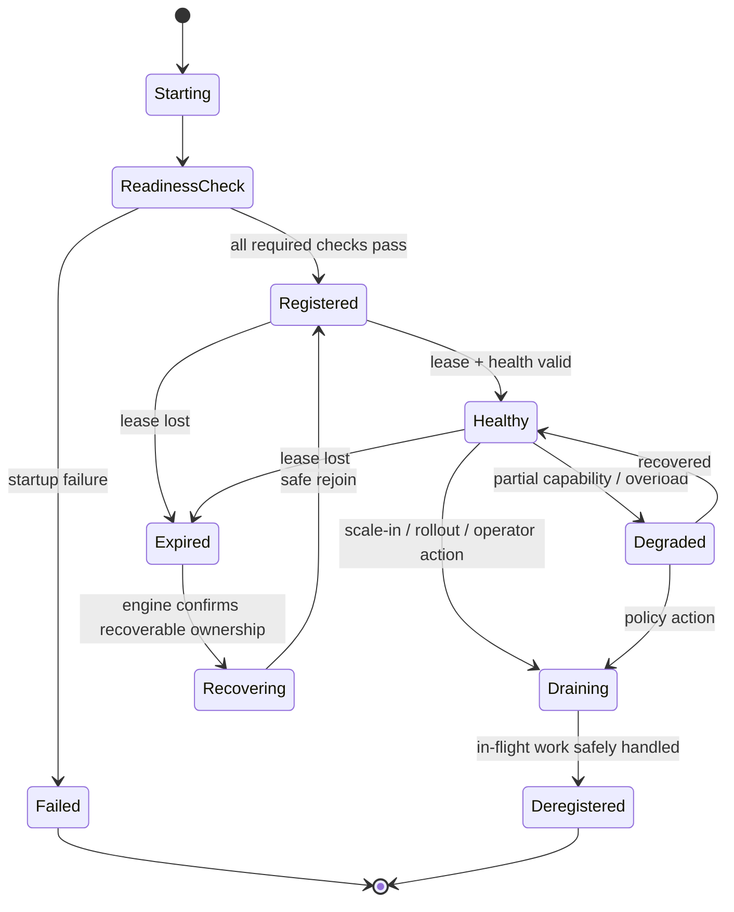

# Distributed Runtime, Service Discovery and Scalability

> Target architecture for Pro/Enterprise. This is not a statement that distributed orchestration, automatic scaling or HA is already shipped. See [edition implementation status](../EDITIONS.md).

## 1. Deployment profiles

| Concern | Community all-in-one | Pro separated runtime | Enterprise distributed |
|---|---|---|---|
| Studio | Co-located | Design plane, separate | Design plane, separate |
| Runtime | In-process / integrated | Generated independent runtime(s) | Fleet of generated runtimes/workers |
| Discovery | Not required | Optional or deployment-specific | Required for dynamic multi-instance routing |
| Scaling | Single instance / vertical | Multiple independently managed services as supported | Horizontal, policy-driven |
| Durable state | Local/integrated; configured persistence | Engine-specific persistence | HA durable state and recovery |
| Management plane | Local Studio operations | Deployment tooling / supported management | Wayang Console and control-plane services |
| HA orchestration | Not an entitlement | Depends on supported deployment | Enterprise capability |

A single generated service can be horizontally replicated by infrastructure, but safe distributed execution still depends on the engine's concurrency and state model.

## 2. Control-plane components

- **Runtime inventory:** stable runtime identity, deployment identity, version, tenant scope, status and capabilities.
- **Registration/lease service:** registration, heartbeat, lease expiry, draining and deregistration.
- **Capability catalog:** engine adapters, component types, protocol versions, resource requirements and compatibility.
- **Placement and dispatcher:** selects an eligible runtime under policy, tenant, locality and capacity constraints.
- **Desired-state reconciler:** compares requested deployment state with observed state and safely converges.
- **Configuration and policy distribution:** versioned non-secret configuration and policy bundles.
- **Artifact resolver:** immutable artifact digest, signature/provenance verification and compatibility checks.
- **Telemetry aggregation:** metrics, logs, traces, audit and deployment events.

The Console is a separate management product. Keep its implementation outside this repository; Wayang defines stable runtime management contracts and local agent behavior.

## 3. Registration contract

A conceptual registration record:

```yaml
runtimeId: runtime-uuid
deploymentId: deployment-uuid
tenantScope: tenant-reference
artifact:
  id: artifact-id
  digest: sha256:...
runtime:
  version: 1.x
  apiVersion: v1
  protocolVersion: v1
capabilities:
  - capability: agent.invoke
    version: 1
  - capability: connector.kafka
    version: 1
resources:
  cpuCapacity: 4
  memoryBytes: 8589934592
  concurrencyLimit: 32
location:
  region: ap-southeast-1
  zone: zone-a
health:
  readiness: READY
  drainState: ACCEPTING
lease:
  expiresAt: timestamp
```

This is illustrative; define and version the actual wire schema before implementation. Do not expose secret values or raw credentials. Tenant scope and location must be validated against trusted deployment identity.

## 4. Discovery lifecycle



Readiness and liveness are distinct. A process can be alive but not ready to receive new work. Capability-level readiness may differ: an instance can serve HTTP connectors while its GPU worker is unavailable.

## 5. Routing and placement policy

Filter candidates in this order:

1. Authenticate caller and establish tenant/principal.
2. Authorize requested capability and target resource.
3. Match capability name/version and invocation protocol.
4. Enforce tenant isolation, region and data-residency constraints.
5. Exclude unhealthy, expired, draining or incompatible instances.
6. Enforce concurrency, quota and backpressure.
7. Rank eligible candidates by locality, queue depth, observed load, priority and fairness.
8. Invoke with deadline, correlation ID and idempotency/operation key.
9. Return typed success/failure; do not retry unsafe operations automatically.

Supported policies may include round-robin, weighted, least-outstanding-work, locality-aware and priority-aware. Policy selection must be explicit and observable. Never use a routing algorithm as a substitute for authorization or tenant isolation.

## 6. Queueing and backpressure

Prefer bounded queues and explicit admission control. Define per-tenant and per-capability concurrency, maximum queue age, payload limits, timeout budgets, retry budgets and overload responses. Propagate deadlines; do not allow each adapter to reset them.

Use durable queues only where the delivery semantics justify them. Document at-least-once delivery and require idempotent consumers for redelivery. Do not promise exactly-once side effects across arbitrary external systems; use idempotency keys, outbox/inbox patterns and reconciliation.

## 7. Ownership of execution state and retries

- Gamelan owns durable workflow run state, scheduling, retry and lifecycle for work delegated to Gamelan.
- Andalus owns agent execution lifecycle and its agent-specific state where delegated to Andalus.
- Integration engine/connector owns protocol-specific delivery and route error handling within its contract.
- BPMN engine owns process tokens, timers, jobs and process recovery.
- Wayang dispatcher owns only dispatch attempt metadata and transport-level failure classification; it must not create a competing semantic retry loop.

For each boundary define who owns timeout, cancellation, retry, compensation, deduplication, checkpoint and final outcome. Persist correlation and causation IDs across boundaries.

## 8. Rollout, drain and recovery

1. Resolve and verify artifact digest, signature and compatibility.
2. Start new instance with no traffic.
3. Run startup and capability readiness checks.
4. Register and wait for discovery propagation.
5. Shift traffic gradually (canary/weighted rollout).
6. Observe error rate, latency, saturation and business outcomes.
7. Mark old instance draining; stop new assignments.
8. Let active work finish or checkpoint according to engine contract.
9. Deregister old instance and terminate.
10. On rollback, route to last known compatible artifact; never silently mutate an immutable artifact.

A failed instance may have completed an external side effect before losing its acknowledgement. Recovery must use idempotency, inbox/outbox, fencing or business reconciliation rather than blindly replaying.

## 9. High availability requirements

- Define SLO, RPO and RTO per service and workflow class.
- Replicate metadata, broker and required durable engine state across failure domains.
- Use quorum/consensus-backed coordination where leases or ownership require it.
- Use fencing tokens/epochs to reject stale workers.
- Keep artifact storage durable and immutable; cache artifacts locally after verification.
- Keep secrets external and rotateable.
- Use zone-aware scheduling and capacity headroom.
- Test loss of worker, zone, broker, database, registry and control plane.
- Back up and regularly restore data; validate recovery, not just backup creation.
- Keep runtime execution independent from Studio and Console availability.

HA does not mean every component must be active-active. A documented active-passive or degraded mode may be safer for some stateful engines.

## 10. Observability contract

Every run/invocation should propagate: trace ID, correlation ID, causation ID, tenant reference, project/release/artifact digest, mode, engine/adapter, runtime ID, capability, attempt, deadline and outcome. Sensitive data must be redacted.

Minimum signals:
- request/queue rate, queue age and depth;
- latency percentiles and timeout counts;
- success, retry, rejection and dead-letter rates;
- worker saturation and concurrency;
- lease renewals, expirations and registration churn;
- artifact/adapter compatibility failures;
- per-tenant quota and capacity;
- workflow/agent business outcomes.

## 11. Required implementation gates

Do not claim Enterprise distributed execution ready until:
- registration and lease schema is versioned and authenticated;
- capability-aware discovery and policy enforcement are tested;
- bounded admission/backpressure exists;
- durable execution ownership and fencing are explicit;
- scale-in/drain does not lose or duplicate work;
- failure and restore tests demonstrate stated RPO/RTO;
- Console outage does not interrupt already-running workloads;
- multi-tenant isolation tests cover state, queues, secrets, artifacts and telemetry.
