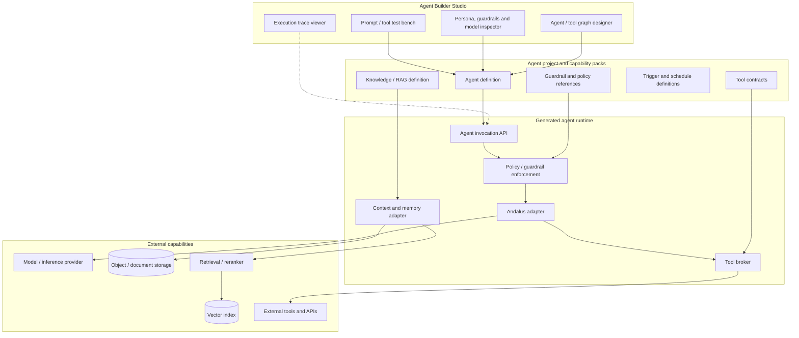
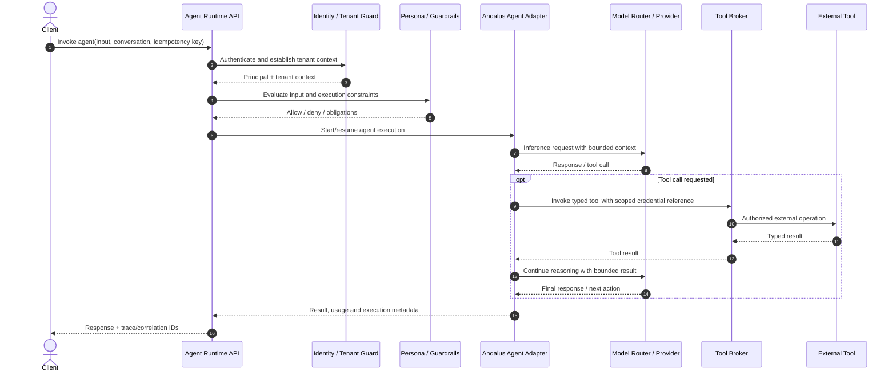
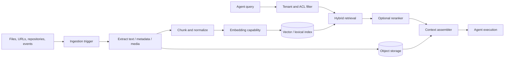
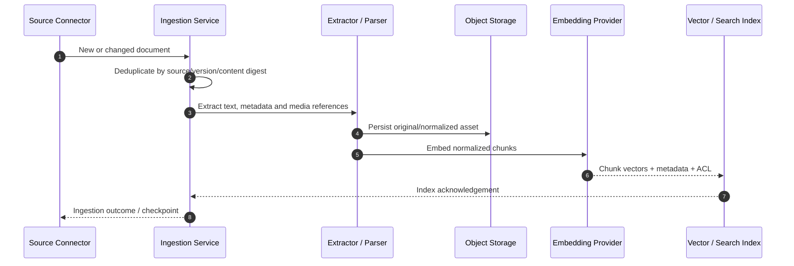
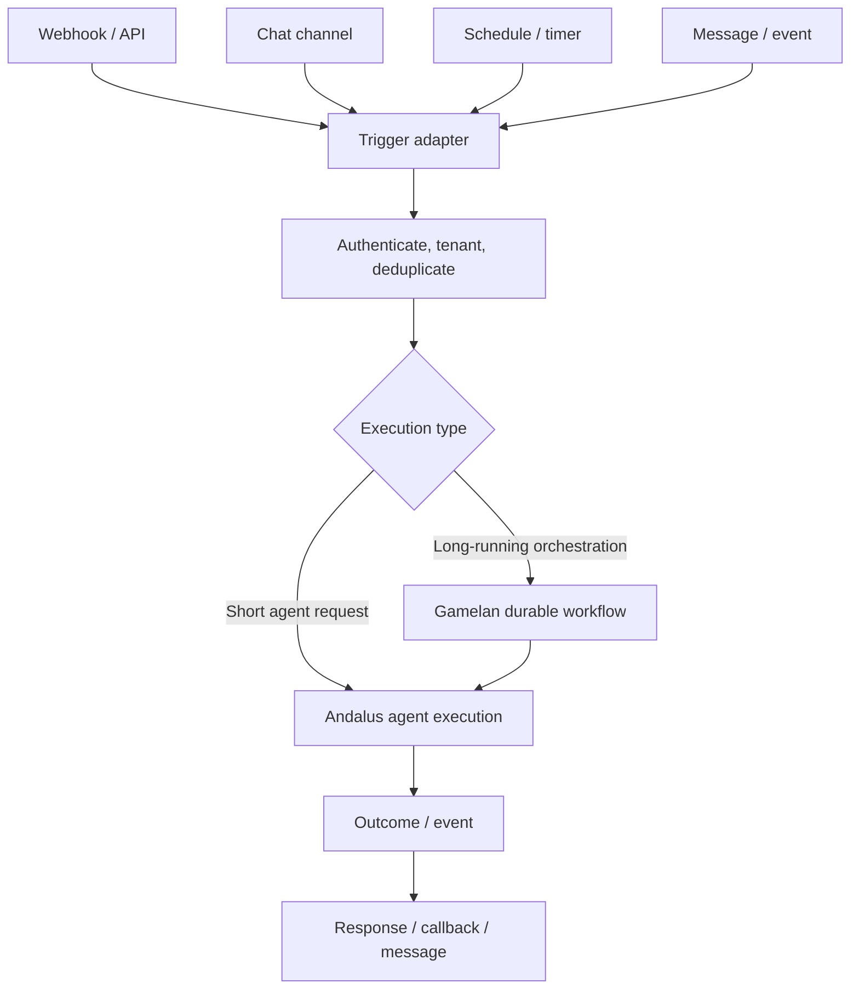

# Agent Builder Mode Architecture

> Target design for the Agent Builder mode. Current agent-related implementation and verification are documented in [RAG](../../RAG.md), [triggers](../../TRIGGERS.md), [release](../../RELEASE.md) and [architecture](../../ARCHITECTURE.md).

## 1. Goals and boundaries

Agent Builder authors agent definitions, tools, model/provider choices, memory, knowledge/RAG, triggers, guardrails and multi-agent composition. It is an authoring mode and capability family, not a replacement for the neutral Wayang core or the durable workflow engine.

- Andalus owns agent execution semantics and agent lifecycle when used through its adapter.
- Gamelan owns durable workflow orchestration for workflows delegated to it.
- Wayang owns project composition, schemas, validation, release compilation and deployment integration.
- Storage, retrieval and model inference are explicit capabilities with typed contracts; they are not hidden implicit node side effects.

## 2. Logical architecture

## 3. Agent invocation sequence

The adapter must define streaming, cancellation, deadline, maximum tool calls/iterations, token/context budgets, idempotency and error mapping. A model timeout is not automatically safe to retry if a tool side effect may already have occurred.

## 4. RAG ingestion and query paths

Storage is an explicit reusable resource. RAG nodes declare required inputs and storage/index dependencies. Missing mandatory data inputs produce visible diagnostics; by default they are advisory and do not block saving, testing, publishing or workflow execution. A connector that cannot proceed returns a typed empty/no-op outcome and a warning rather than fabricating data. Only an explicitly declared hard precondition may block execution. Separate source object storage, extracted document metadata and vector/lexical indexes. Enforce tenant and source ACL filters before returning chunks.

### Ingestion sequence

## 5. Triggers, schedules and durable execution

Use the durable workflow engine when the use case needs persisted waits, timers, retries, human approval or multi-step recovery. Do not use an in-memory agent request loop as a substitute for durable process state.

## 6. Security and operations

- Persona is descriptive behavior; guardrails and policy enforcement are executable controls. Never treat prompt text as the security boundary.
- Tool permissions are least-privilege and tenant-scoped. Resolve secret references at invocation time; never package secret values.
- Bound model calls, tool calls, output size, context size, spend and execution time.
- Apply retrieval ACLs and tenant filters before context reaches the model.
- Record model/provider, model version, prompt/template version, tool calls, policy decisions, token/cost metrics and trace IDs with sensitive payload redaction.
- Support cancellation and distinguish cancelled, timed out, denied, failed and completed outcomes.
- Define retention and deletion for conversation state, memory and indexed content.

## 7. Scaling

Scale stateless invocation/API and tool workers horizontally. Scale ingestion, embedding and retrieval separately because their CPU, memory, I/O and GPU profiles differ. Use bounded queues and tenant quotas. Keep agent conversation/session state in an explicit persistence adapter if it must survive instance replacement. Use sticky routing only as an optimization, never as the only durability mechanism.

For Enterprise, capability discovery can advertise agent execution, model/provider access and resource classes. Placement must honor tenant, region, data residency, model availability and GPU constraints. Andalus remains owner of agent execution state; Gamelan remains owner of durable workflow lifecycle.
