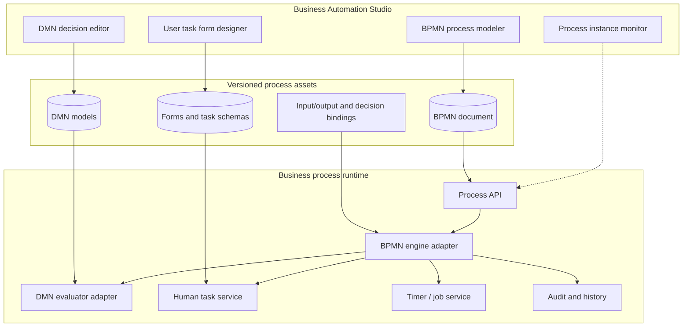
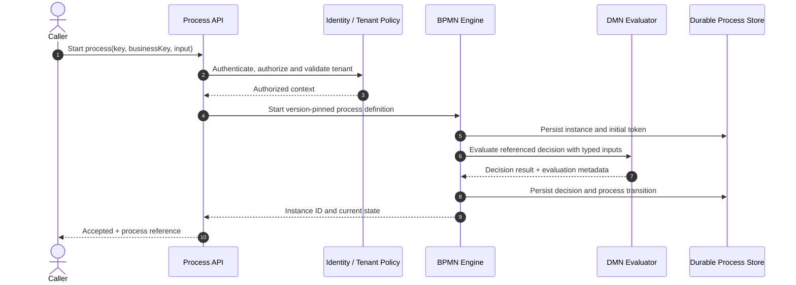
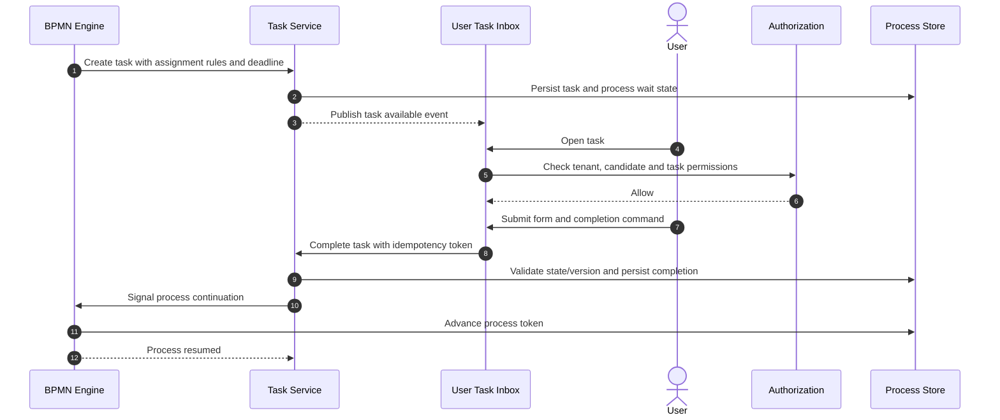
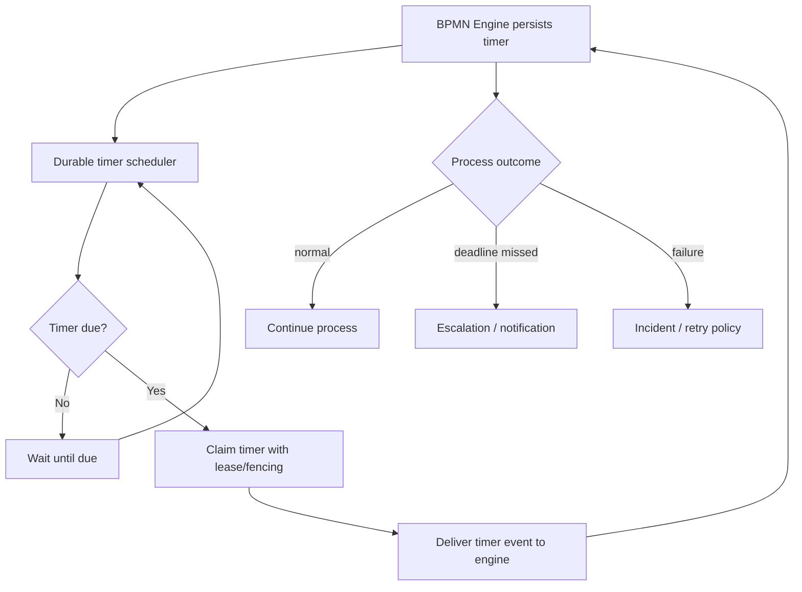
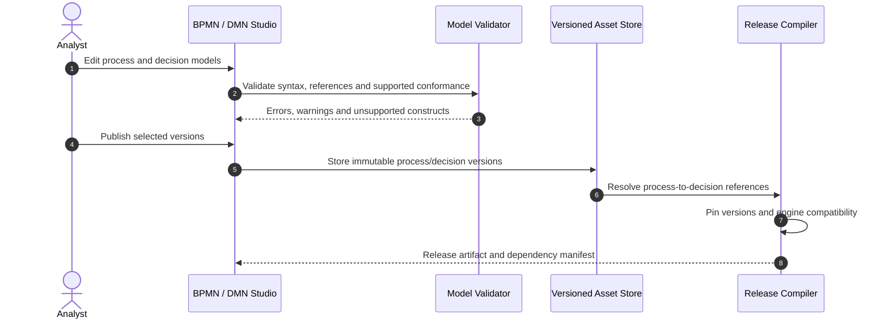

# Business Automation Mode Architecture

> Target architecture for BPMN and DMN authoring and execution. Current supported subsets and limitations must be taken from implementation documentation and tests; this document does not assert full BPMN 2.0 or DMN conformance.

## 1. Goals and domain boundaries

Business Automation provides native BPMN process modeling, DMN decision modeling, human tasks, timers, escalation, process monitoring and governed lifecycle.

- BPMN owns process control flow, tokens, events, timers, subprocesses and process state.
- DMN owns deterministic decision model evaluation and hit-policy semantics within the supported conformance profile.
- Wayang owns Studio authoring, project references, validation boundaries, capability packs, release compilation and integration with identity/operations.
- A BPMN-compatible engine owns process execution and recovery. A DMN evaluator owns decision evaluation. Gamelan may orchestrate broader workflows but must not silently replace BPMN semantics.

## 2. Logical architecture

## 3. Process start and decision sequence

The process must pin or explicitly resolve process and decision versions at start. Do not let an in-flight instance unexpectedly change semantics because a newer model was published.

## 4. Human task lifecycle

Human tasks need assignment/candidate rules, tenant isolation, optimistic concurrency, due dates, escalation, delegation, audit history and idempotent completion. UI availability is not authorization.

## 5. Timers, escalation and recovery

Timers must survive process and worker restarts. Scheduler delivery may be at-least-once; engine-side timer identity and idempotency prevent duplicate transitions. Define timezone, daylight-saving and calendar semantics explicitly.

## 6. BPMN / DMN document lifecycle

Never silently drop unsupported BPMN/DMN constructs during import/export. Show explicit diagnostics and preserve source documents where round-trip fidelity is not supported.

## 7. Scaling and HA

Scale stateless process APIs and task inbox services horizontally. Scale job executors according to ready-job backlog and process-engine concurrency. Stateful process execution requires a durable engine store and safe job acquisition/locking; use the selected engine's supported clustering model rather than inventing a competing token scheduler.

Ensure single ownership of timers/jobs through engine-native locks or fencing. Human-task stores and process state must share reliable transaction/outbox boundaries or recoverable reconciliation. Test worker loss during job execution, timer firing, task completion and process migration. Define process version migration separately; do not mutate running instances implicitly.

## 8. Conformance and engine selection gates

Before selecting or shipping a BPMN/DMN engine, record:
- supported BPMN/DMN specification versions and profiles;
- supported events, gateways, tasks, subprocesses, compensation and transaction semantics;
- DMN hit policies, FEEL support and type behavior;
- import/export and diagram interchange fidelity;
- persistence, clustering, job acquisition and recovery model;
- licensing, extension model, Java/Quarkus compatibility and operational footprint;
- test suite and interoperability evidence.

Expose conformance limitations in Studio and docs. Do not market a subset as full standard compliance.
