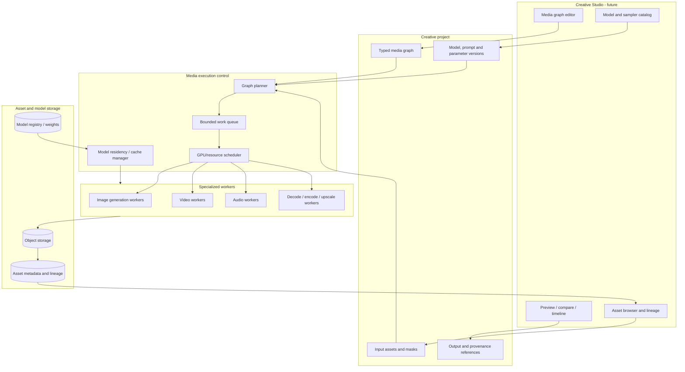
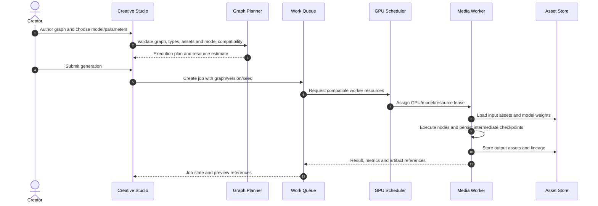

# Creative Content Mode Architecture (Future)

> Exploratory target only. Not a launch commitment and not a dependency of the initial Wayang modes.

## 1. Scope

A future mode inspired by node-based creative systems may author image, audio, video, animation, 3D or multimodal generation pipelines. It requires media-specific graph semantics, asset lineage, previews, model management and GPU-aware execution. Do not treat a general workflow graph as a complete media graph.

## 2. Future logical architecture

## 3. Media graph execution sequence

## 4. Resource scheduling and scaling

Workers advertise capabilities such as operation type, model availability, VRAM class, precision, accelerator type, supported codecs and concurrency. Placement must account for model download/startup cost, GPU memory, batching, locality to assets, fairness and tenant quotas.

Use bounded queues, cancellation, resource leases, preemption policy (if supported), checkpoint/resume and cleanup of temporary assets. Scale workers by queue age, GPU utilization, VRAM pressure and job class, not CPU alone. Large assets should move by object reference or streaming protocol, not through the control plane.

## 5. Asset lifecycle and provenance

Each output should retain parent asset IDs, graph and node versions, model identifier/version/digest, prompt/parameter references, seed where applicable, execution environment, timestamps, license/provenance metadata and transformation lineage. Keep binary media in object storage; store metadata and references in project/runtime state.

## 6. Reuse and separation

Reuse Wayang's project, capability-pack, schema, artifact and deployment contracts. Keep media graph model, preview/timeline UI, model residency, GPU scheduling and streaming media transport in the future Creative pack and specialized worker services. Do not add GPU scheduling concepts to neutral core or BPMN/DMN semantics.
