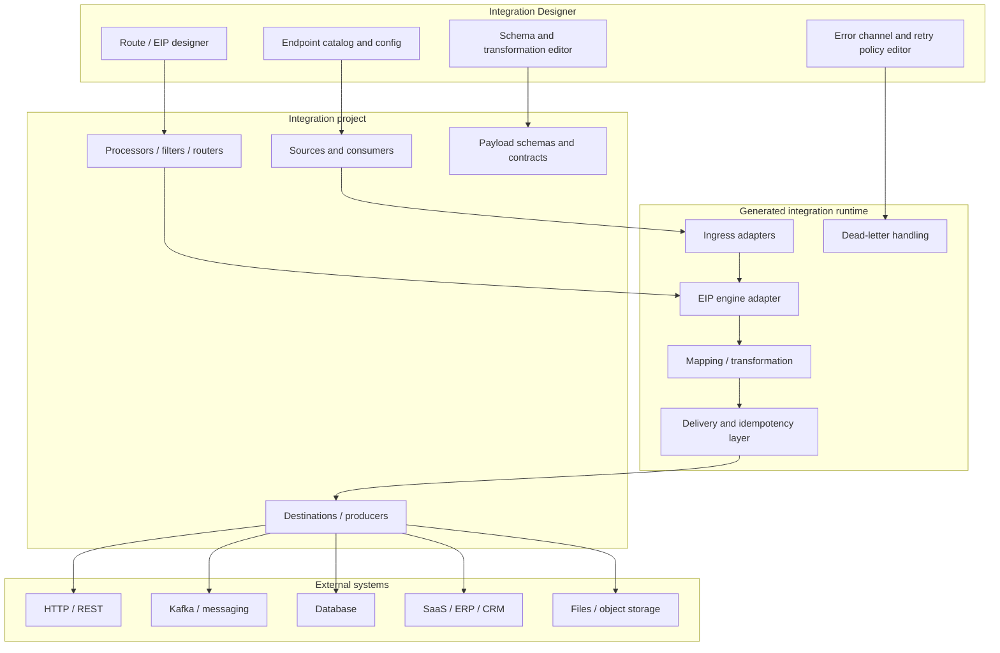
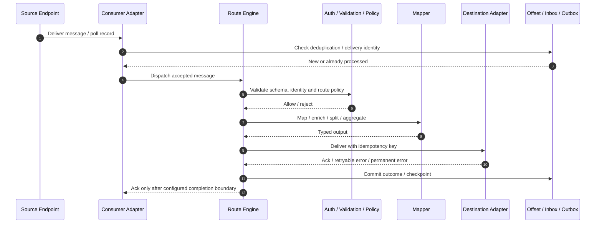
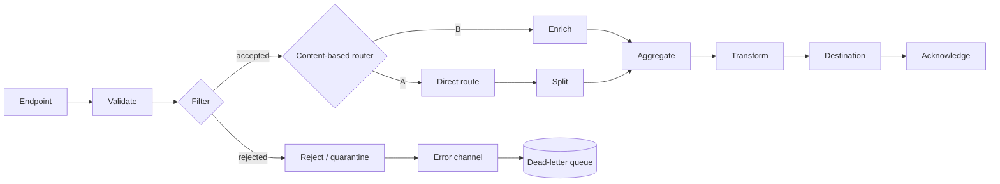
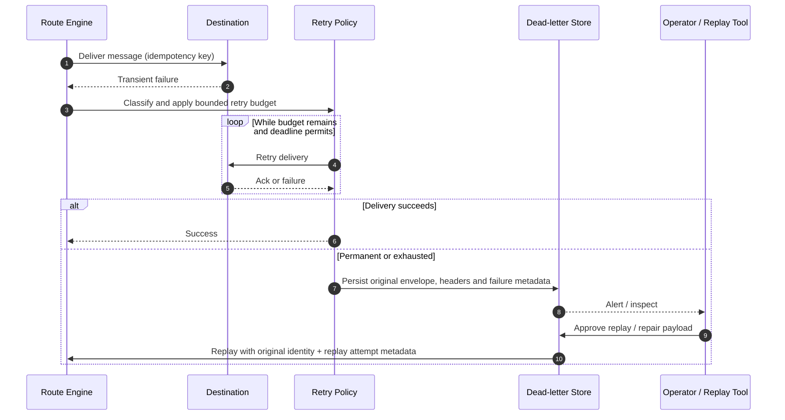

# Integration / ESB Mode Architecture

> Target architecture for Integration / ESB. The selected integration engine and its exact EIP coverage remain subject to dependency and conformance decisions.

## 1. Goals and boundaries

The mode models enterprise connectivity: endpoints, routes, processors, transformations, routing, messaging, error channels and operational policies. It should feel like an integration product, not an agent canvas with a different palette.

Wayang owns route authoring, schemas, validation, capability packs, packaging and deployment contracts. A mature integration engine/component ecosystem (Apache Camel is a candidate/reference) should own protocol and EIP execution where appropriate. Do not reimplement every transport and EIP primitive in Wayang core.

## 2. Logical architecture

## 3. Message route execution sequence

The acknowledgement and offset-commit boundary must be explicit. Avoid acknowledging before durable acceptance when at-least-once delivery is required.

## 4. EIP routing patterns

The pack catalog should group patterns by semantics: channel adapters, message construction, routing, transformation, endpoint interaction, system management and error handling. Each node documents delivery guarantees, ordering, concurrency, transaction support and resource requirements.

## 5. Retry and dead-letter sequence

Do not retry non-idempotent side effects blindly. Define poison-message handling, retention, encryption, access control, replay authorization and audit. Preserve original message identity and add a distinct replay attempt ID.

## 6. Delivery semantics and operations

- Document at-most-once, at-least-once or transactional semantics per connector/route; do not claim end-to-end exactly-once across arbitrary external systems.
- Define ordering key/partition behavior, consumer group ownership and concurrency.
- Use inbox/outbox and idempotency keys where needed.
- Bound retries by attempt count, backoff, jitter and total deadline.
- Make DLQ replay explicit, authorized, observable and auditable.
- Protect against SSRF, unsafe redirects, private/metadata network access, credential leakage and unbounded payloads.
- Store connector credentials as secret references; redact headers and payload fields.
- Support schema evolution and compatibility checks at route boundaries.

## 7. Scaling and high availability

Scale consumers by partitions or source concurrency and destinations by independent throughput limits. Scale stateless transformation workers horizontally. Preserve partition/order affinity where required. Use backpressure so a slow destination cannot create unbounded memory growth.

For distributed deployments, register runtime capabilities and connector availability in discovery. Use partition/lease ownership or the broker's consumer-group protocol rather than assigning the same partition to multiple active consumers. Rebalance gracefully: stop intake, finish/commit safe work, release ownership, then start replacement consumers. Store offsets/checkpoints durably and test broker, database and destination outage recovery.

A route may be deployed as a dedicated minimal integration runtime. Avoid loading agent/BPMN engines unless the artifact requires them.
