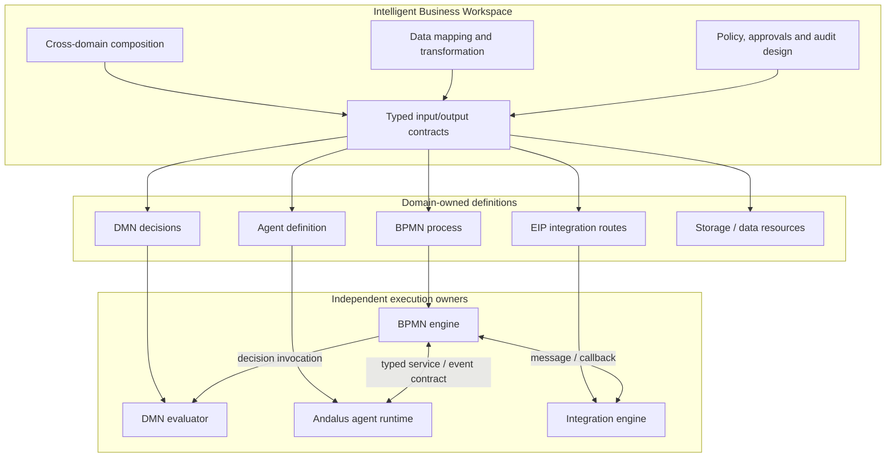
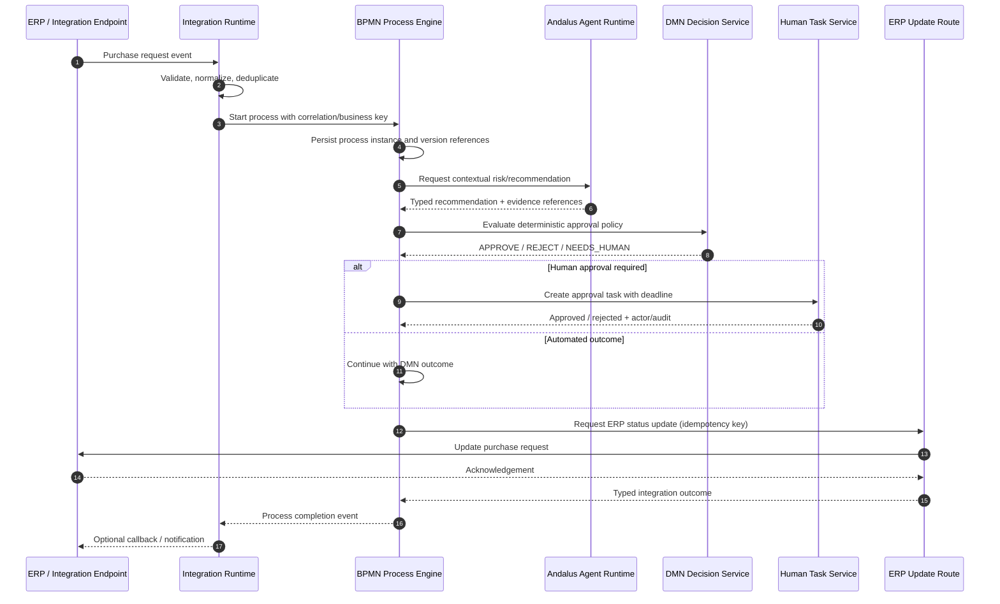
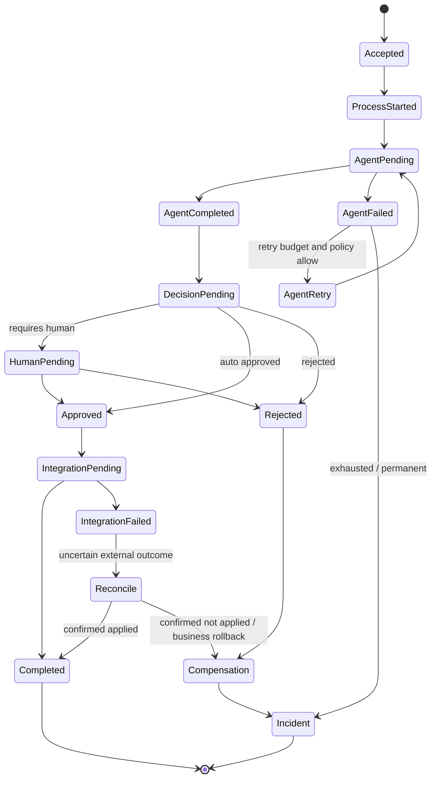

# Intelligent Business Automation Mode Architecture

> This mode composes Agent, Integration, BPMN, DMN, data and human capabilities. It is a Studio composition experience and cross-domain contract layer, not a separate workflow engine.

## 1. Purpose and ownership

Use this mode for end-to-end business solutions where deterministic process governance, integration and AI reasoning cooperate.

- BPMN owns the governed process lifecycle when a BPMN process is used.
- DMN owns deterministic business decision evaluation.
- Andalus owns agent execution.
- Integration engine/connectors own endpoint and EIP semantics.
- Gamelan owns durable orchestration when a workflow is explicitly delegated to it.
- Wayang owns cross-domain authoring, typed bindings, dependency resolution, deployment packaging and cross-engine observability context.

## 2. Reference architecture

## 3. Procurement approval sequence

The agent provides contextual recommendation, not an ungoverned authorization decision. Deterministic policy and human approval remain explicit process steps.

## 4. Cross-engine invocation contract

Every boundary must carry:
- contract name and version, typed input/output schema;
- tenant/principal and delegated authorization context;
- correlation, causation, business and idempotency identifiers;
- deadline, cancellation token and execution budget;
- trace context and artifact/process/agent version references;
- typed error categories and retryability;
- data classification, residency and retention obligations.

Never pass engine-internal object references or rely on shared JVM memory across runtime boundaries. Prefer schema-versioned messages or service contracts.

## 5. Failure, retry and compensation

Compensation is a business action, not a database rollback. Each side effect needs a defined compensating action or reconciliation path. If a timeout occurs after an external system may have committed, query/reconcile before retrying.

## 6. Deployment topology

A mixed-mode solution can be deployed as one generated runtime when the required engines can safely coexist, or as multiple services when isolation, independent scaling or engine requirements demand it. The artifact manifest declares the topology and cross-service contracts. Do not assume one runtime per mode or one runtime per project.

## 7. Governance, security and observability

- Apply policy at entry and at each engine boundary; propagate trusted tenant/principal context.
- Treat agent output as untrusted input to BPMN/DMN and integration steps; validate against schemas and policy.
- Keep human decisions attributable and auditable.
- Use outbox/inbox and idempotency for cross-engine event delivery.
- Propagate trace/correlation/business keys through every engine.
- Record model/agent version, decision version, process version, route version, artifact digest and human actor.
- Redact secrets and sensitive business payloads from traces.
- Define data retention and regional placement across all participating engines.

## 8. Scaling

Scale each engine according to its own workload profile: integration consumers by partition/endpoint throughput, BPMN jobs by ready-job backlog, agent workers by inference concurrency and provider quotas, DMN evaluators by request rate (often stateless). Avoid scaling the whole solution as one unit when bottlenecks differ. Enforce tenant quotas and end-to-end deadlines. Use durable event contracts for cross-service boundaries and preserve ordering only where business semantics require it.
