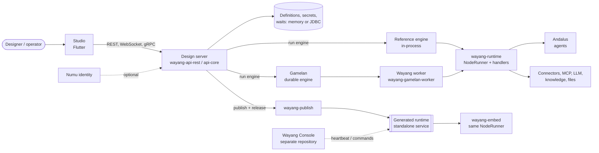
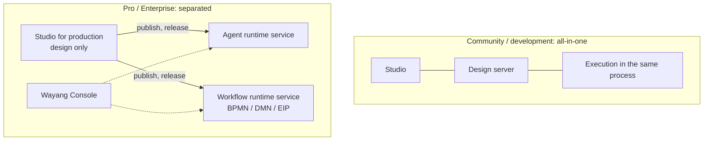
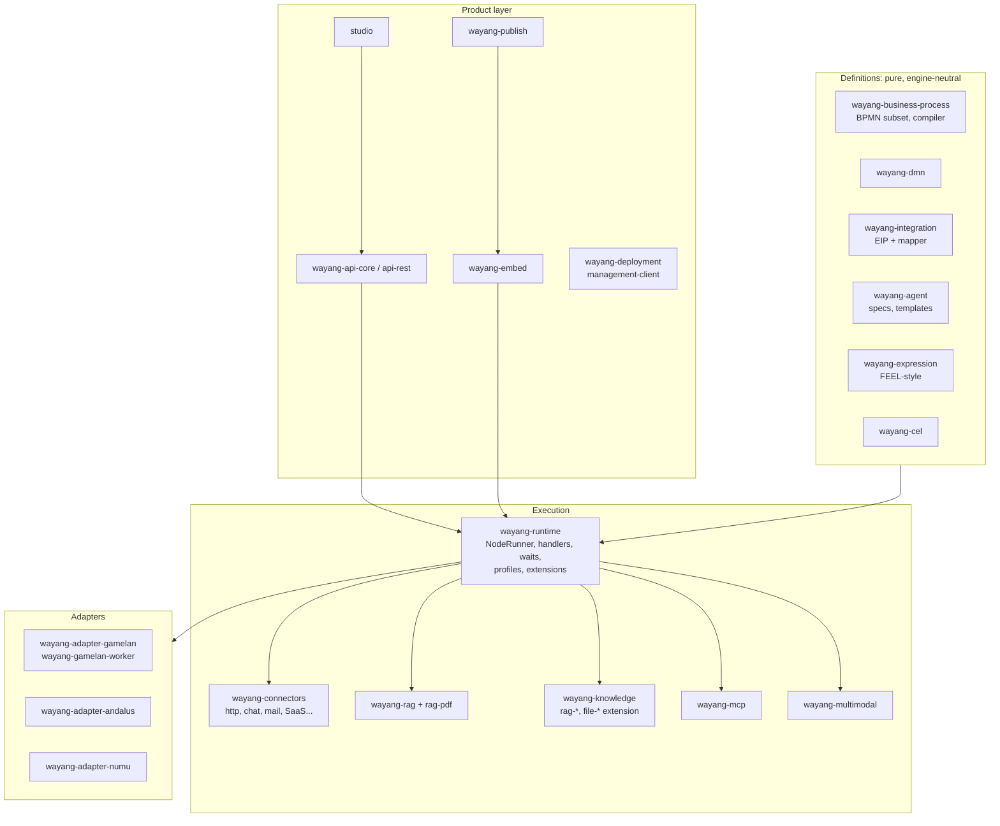
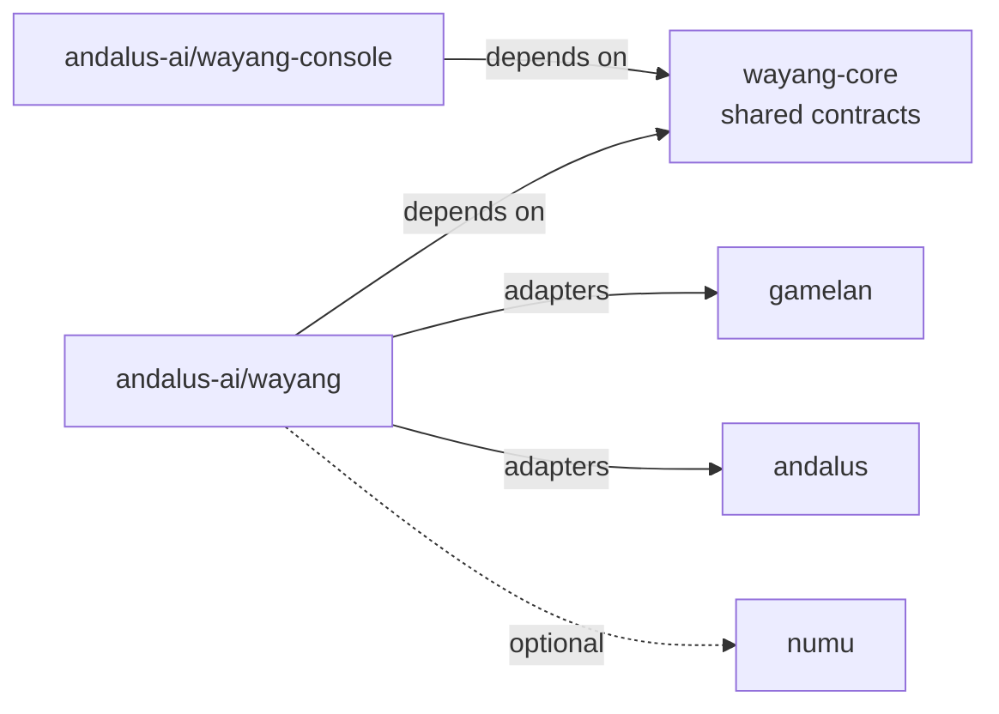

# 1. System architecture

## Principles

- Wayang owns **definitions** (what to run); it never implements a second durable workflow engine.
- **Gamelan** owns durable execution (scheduling, retries, persistence, run history). **Andalus** owns agent execution (models, tools, memory). **Numu** (optional) owns identity and tenancy.
- One definition model, several execution topologies. Engine-neutral at the Wayang boundary: no Gamelan or Andalus types in the definition modules.
- Honest verification: documents say what was tested and how.

## Context

## Planes

| Plane | Product | Responsibility |
|---|---|---|
| Design | Studio + design server | compose, validate, test, version, publish definitions |
| Execution | generated runtimes, or the in-process engine in Community | run published definitions |
| Management | Wayang Console (own repository) + a Management Agent inside each runtime | inventory, deploy, observe, govern |

No runtime needs the Console or Studio to keep executing.

## Two editions from one codebase

The design server's mode is `WAYANG_MODE` (`community` executes, `design` refuses to execute). Details and status (what exists, what is proposed): [EDITIONS.md](../EDITIONS.md).

## Layers and modules

Dependency direction is one-way: definitions know nothing of execution; execution knows nothing of the API; adapters implement ports defined here. The full module table is in the root [README](../../README.md).

## Boundaries with other repositories

Core must never depend on Wayang or the Console. Console persistence, fleet registry and UI live only in the Console repository (`AGENTS.md`).
