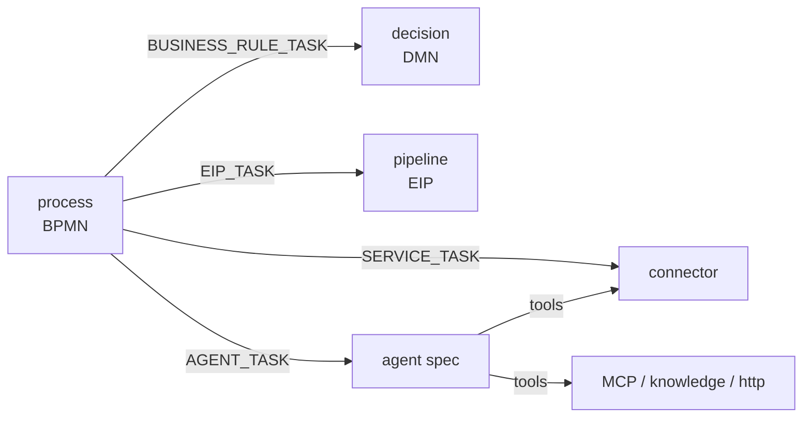
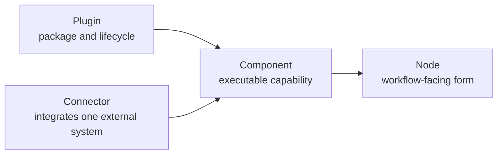
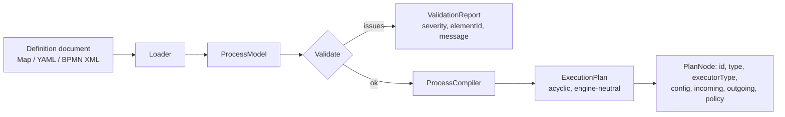
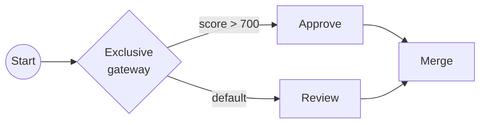

# 2. Definitions, nodes and the plan

## Four kinds of definition

Studio and the API store four kinds, each with drafts (optimistic `If-Match` revisions) and immutable published versions.

| Kind | What it is | Module | Semantics kept |
|---|---|---|---|
| `process` | BPMN subset: events, gateways, tasks, waits | `wayang-business-process` | sequence flows, active/dead paths, gateway rules |
| `decision` | DMN decision tables and graphs | `wayang-dmn` | hit policies UNIQUE, FIRST, ANY, COLLECT, RULE ORDER, aggregators |
| `pipeline` | Enterprise Integration Patterns | `wayang-integration` | messages, headers, routing, splitting, aggregation |
| `agent` | declarative agent spec | `wayang-agent` | model, prompt, tools, limits, approvals |

They are not flattened into one generic node type: a process *references* decisions, pipelines and agents (an `BUSINESS_RULE_TASK` evaluates a decision, an `EIP_TASK` runs a pipeline, an `AGENT_TASK` runs an agent). A process can only be published if what it references is published.

## Node (element) types

Process elements (`ElementType`). Each maps to one executor type; a wait element completes later.

| Element | Executor | Wait | Purpose |
|---|---|---|---|
| `START_EVENT`, `END_EVENT` | `wayang-bpmn` | no | entry and exit |
| `EXCLUSIVE_GATEWAY` | `wayang-bpmn` | no | first matching condition, else the default flow, else the run fails |
| `PARALLEL_GATEWAY` | `wayang-bpmn` | no | all flows; a join waits for all live inputs |
| `INCLUSIVE_GATEWAY` | `wayang-bpmn` | no | every matching flow, else default |
| `SERVICE_TASK` | `wayang-service` | no | call a **connector** (`config.connector`), or an extension handler via `config.executorType` |
| `BUSINESS_RULE_TASK` | `wayang-dmn` | no | evaluate a decision |
| `AGENT_TASK` | `wayang-agent` | no | run an agent through the `AgentInvoker` |
| `EIP_TASK` | `wayang-eip` | no | run a pipeline |
| `USER_TASK` | `wayang-human` | **yes** | form/approval completed by a person |
| `TIMER_EVENT` | `wayang-bpmn` | **yes** | wait for a duration or date |
| `MESSAGE_CATCH_EVENT` | `wayang-bpmn` | **yes** | wait for a correlated message |

Rejected at validation (not silently converted): cycles and loops in a process, sub-processes, boundary events, multi-instance. (Loops exist *inside* an EIP pipeline.)

### Words that are easy to confuse

A **node** is what a designer drops on the canvas; a **component** is the registered, versioned capability behind it (`ComponentDescriptor`, exact id and version, `GET /catalog/components`); a **connector** is the code that talks to one external system and is selected by `config.connector`; a **plugin** is the package that ships components.

## Per-node configuration

Every node's `config` is validated against a closed JSON-Schema subset (`NodeCatalog`, served as `GET /catalog/nodes`; the Studio inspector is generated from it). Unknown keys are an error, so a new key must be added there (see the [developer guide](06-developer-guide.md)). Common keys:

| Key | Meaning |
|---|---|
| `connector`, `inputs`, `inputMapping`, `outputMapping`, `outputMap` | which connector, and how variables map in and out |
| `retries`, `retryDelay`, `retryMaxDelay`, `retryBackoff`, `timeout`, `onError` | per-node policy (`NodePolicy`); `onError: continue` turns the last failure into `<node>.failed=true` |
| `${secret:NAME}`, `${config:NAME}` | secret and setting references resolved at call time, never stored |
| condition on a flow | an expression (FEEL-style) over `<nodeId>.<key>` variables |

## From definition to plan

`ExecutionPlan(processId, processName, nodes)` is the only thing an engine sees. Each `PlanNode` carries its incoming and outgoing flows with conditions, so executors hold no state. Validation runs live in Studio (`POST /definitions/{kind}/validate`) and again at publish (invalid gives 422).

## How a graph runs on a dependency-only scheduler

Gamelan starts a node when all `dependsOn` nodes are COMPLETED and does not evaluate branch conditions. Wayang therefore uses **dead-path elimination**:

A node is *active* if any incoming flow is live (a parallel join: all). An inactive node does no work, emits `active=false` and kills all its outgoing flows. In the diagram, if `score > 700`, `Review` is inactive and `Merge` still runs because one input is live. Outputs of a node become variables `<nodeId>.<key>`.

## Decisions (DMN)

A decision is a table (inputs, outputs, rules) or a graph of tables whose dependencies are inferred. The hit policy decides what several matching rules mean (UNIQUE errors on more than one match; FIRST takes the first; ANY requires equal outputs; COLLECT returns a list or an aggregate). `POST /tools/decision-test` tests a decision without a run.

## Pipelines (EIP)

A pipeline is a list of steps over a `Message` (payload plus headers). Selected steps: `map`, `transform`, `parse`/`serialize`, `filter`, `router`/`choice`/`switch`, `splitter`, `aggregate`, `collect` (across runs, durable), `multicast` (scatter-gather), `resequence`, `call` (enrich, wire tap), `idempotent`, `claimCheck`, `validate`, `retry`, `circuitBreaker`, `throttle`, `delay`, `loop`, `routingSlip`. The mapping from the classic pattern catalog to steps is in [EIP.md](../EIP.md).

## Agents

An agent spec has `id`, `name`, `model`, `systemPrompt`, `inputTemplate`, `tools` (each `{name, type, config, parameters}`), `maxSteps` (max 50), `timeoutSeconds` (max 3600), `requireApproval` (tools that wait for a person), `outputKeys` and `options`. A tool `type` is the **connector name**; the author fixes `config`, the model supplies only the arguments. `AgentTemplate` makes agents from `${param}` templates (for example the `knowledge-assistant` starter). See [ANDALUS-AGENT-MAPPING.md](../ANDALUS-AGENT-MAPPING.md) and [STUDIO-AGENTS.md](../STUDIO-AGENTS.md).
