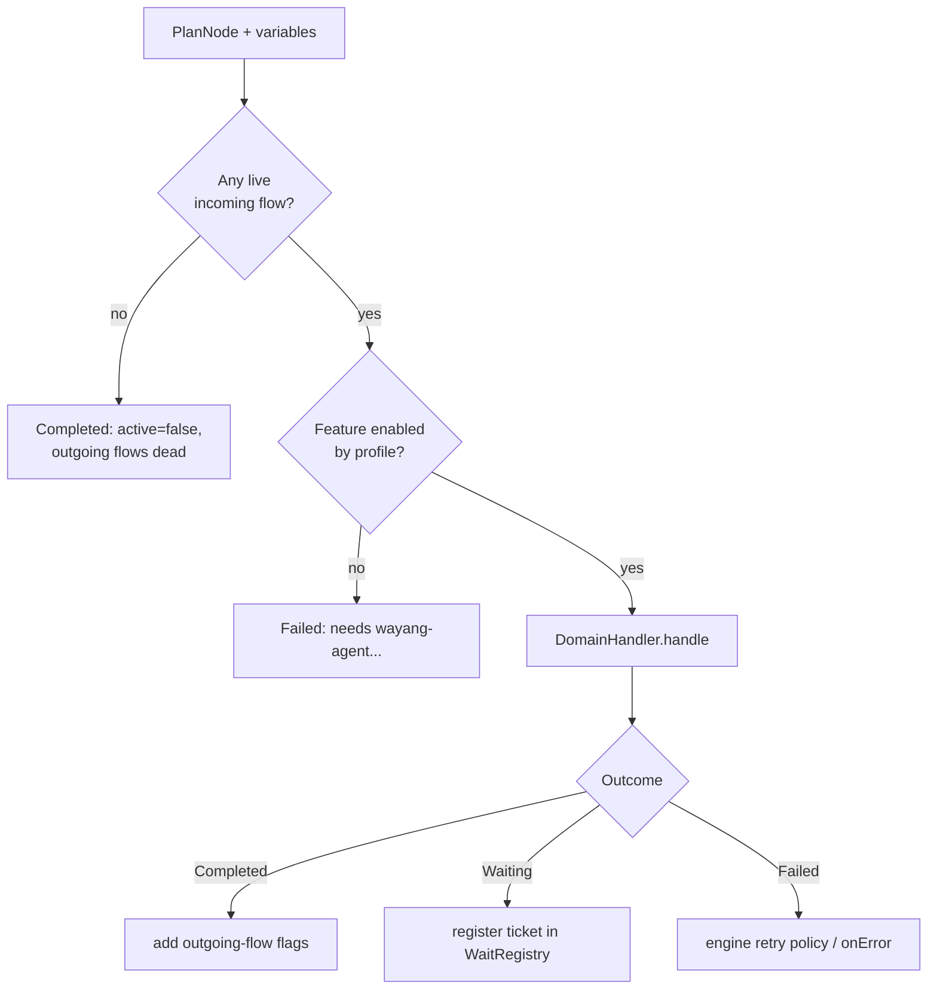
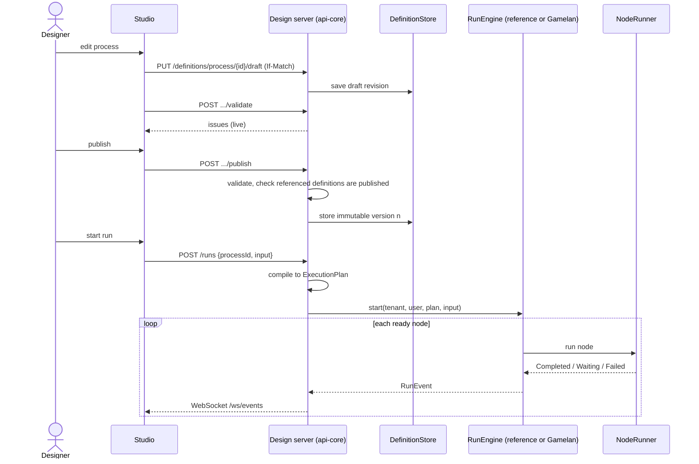
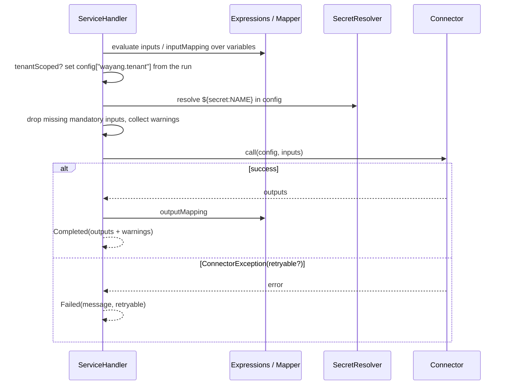
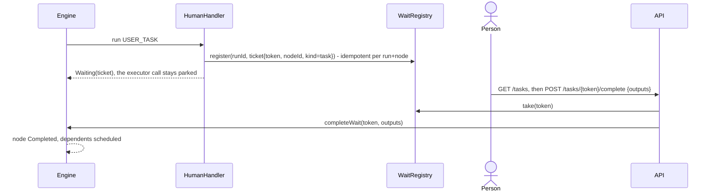
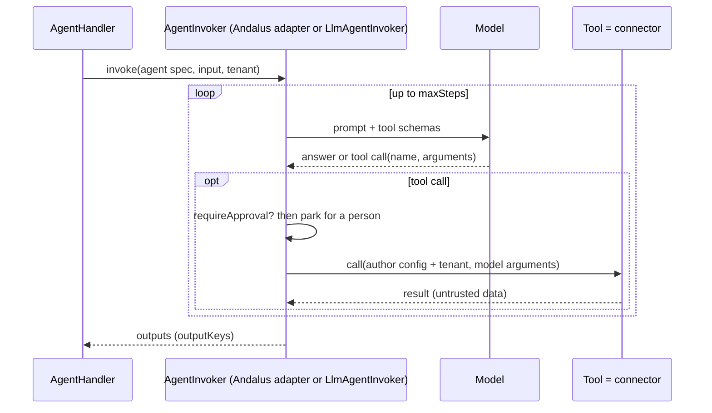
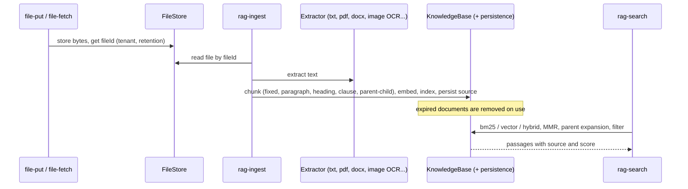
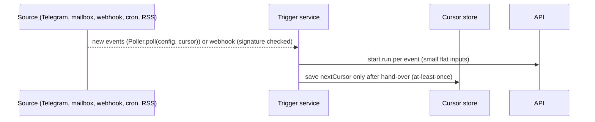

# 3. Execution and sequences

## The node runner

`NodeRunner` takes a `PlanNode` and the run's variables and returns a `NodeOutcome`: `Completed(outputs)`, `Waiting(ticket)` or `Failed(error, retryable)`. It picks the `DomainHandler` for the node's executor type, handles dead paths and flow flags, and applies the profile (a handler for a disabled feature is dropped, so the node fails with a clear message). A handler never throws for an expected failure; it returns `Failed`.

Handlers: `ControlHandler` (events, gateways), `ServiceHandler` (connectors), `DmnHandler`, `EipHandler`, `AgentHandler`, `HumanHandler`; an extension adds its own `DomainHandler` for a custom `executorType`.

## Sequence: design to a finished run (Community, in-process)

## Sequence: a service task calling a connector

A missing **mandatory** input never stops a run: the connector gets no value, the node adds a `warnings` entry, and the run completes. Error messages never include secret values.

## Retries, timeouts, errors

`retries` (0..10) are extra attempts with `retryDelay`, `retryMaxDelay`, `retryBackoff`; `timeout` is per attempt; `onError: continue` makes the last failure a completed node with `failed=true` and `error=<message>` so a gateway can route on `<node>.failed`. Gamelan retries every failure, so make connector calls idempotent before enabling retries. Routing errors (no matching flow) always fail the run. Details and engine facts: [ARCHITECTURE.md](../ARCHITECTURE.md).

## Sequence: human task, timer and message waits

Timers: a ticket with `dueAt`; a ticker (every 5 s) calls `fireDue()`. Messages: `POST /messages {name, correlationKey, payload}` completes a matching wait or is **buffered** (bounded) until the wait parks. Tickets are durable with `wayang.store=jdbc`; the parked executor call itself still lives in the executor JVM (a known limit in ARCHITECTURE.md).

## Sequence: an agent step with a tool call

Tool results, retrieved passages and fetched pages are **untrusted data** and are passed to the model as such, never as instructions. The run's tenant is injected into tenant-scoped tools by the engine; the model cannot choose it.

## Sequence: RAG (knowledge) ingest and answer

The knowledge base is keyed by tenant and name, kept in memory and rebuilt from stored sources after a restart. More in [RAG.md](../RAG.md).

## Sequence: triggers

Pollers are stateless (the caller owns the cursor), webhooks verify provider signatures. See [TRIGGERS.md](../TRIGGERS.md).

## Tenancy, identity and RBAC

Every API call carries a tenant from the authenticated principal (JWT claim `tenant_id` by default, or Numu). Definitions, runs, secrets, knowledge bases and files are keyed by tenant. Roles: VIEWER < OPERATOR < DESIGNER < ADMIN ([API.md](../API.md), [IDENTITY.md](../IDENTITY.md)). A generated release has one tenant (`release`) and an API key.
