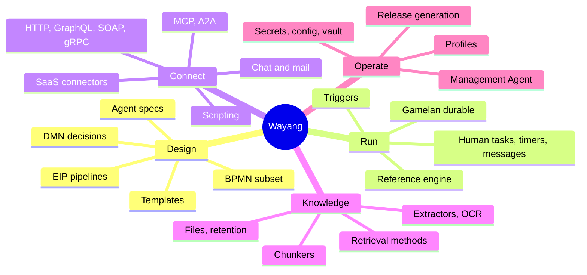
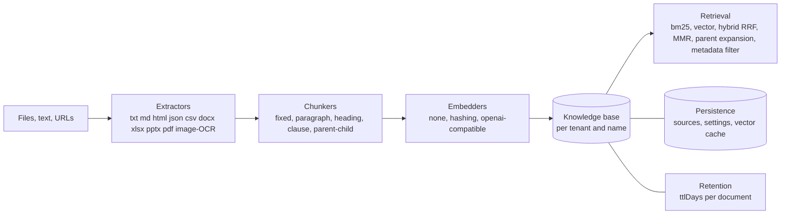

# 4. Features

A map of what Wayang offers, grouped by what you build. Each row links to the document that holds the detail and status.

## Design

| Feature | Notes | Detail |
|---|---|---|
| BPMN subset with import/export of BPMN 2.0 XML | unsupported elements are rejected, not ignored | [ARCHITECTURE](../ARCHITECTURE.md) |
| DMN tables and graphs, hit policies, aggregators | tested with `POST /tools/decision-test` | [STUDIO-DMN](../STUDIO-DMN.md) |
| EIP pipelines and the declarative mapper | pattern catalog mapped to steps | [EIP](../EIP.md) |
| Agent specs and `AgentTemplate` | tools are connectors | [STUDIO-AGENTS](../STUDIO-AGENTS.md) |
| Starter templates | `GET /templates`, `POST /templates/{id}/instantiate` (dry run first); for example `assistant-telegram`, `knowledge-assistant` | [API](../API.md) |
| Live validation, schema-generated inspector, auto layout | the palette and forms come from `GET /catalog/nodes` | [STUDIO-CANVAS](../STUDIO-CANVAS.md) |

## Run

| Feature | Notes | Detail |
|---|---|---|
| Reference engine and Gamelan engine | `wayang.engine=reference|gamelan`; Gamelan path not run against a live engine from this repository | [API](../API.md) |
| Waits: human tasks, timers, messages | tickets in a `WaitRegistry` (memory or JDBC) | [ARCHITECTURE](../ARCHITECTURE.md) |
| Triggers | Telegram, Slack, WhatsApp, webhooks (signed), cron, RSS, GitHub, mail polling; at-least-once with a cursor | [TRIGGERS](../TRIGGERS.md) |
| Approvals in chat, guardrails (spend, rate, untrusted output) | for agent assistants | [TRIGGERS](../TRIGGERS.md) |
| Live run view | WebSocket `/ws/events`, collaboration rooms | [API](../API.md) |

## Connect

Connectors are selected by `config.connector` (or as an agent tool `type`). All outbound calls pass an SSRF guard (`WAYANG_CONNECTORS_ALLOWED_HOSTS`, `WAYANG_CONNECTORS_ALLOW_PRIVATE`); redirects are not followed; secrets are `${secret:NAME}`.

| Family | Connectors |
|---|---|
| Web and protocols | `http`, GraphQL, SOAP/WSDL, gRPC (Connect), WebSocket |
| Chat and mail | Telegram, Slack, WhatsApp, Discord, Teams, Gmail, SMTP, IMAP, Resend, Twilio ([MAIL](../MAIL.md), [EMAIL](../EMAIL.md)) |
| SaaS | GitHub, Notion, Google Calendar and Sheets, Airtable, Todoist, Linear, Trello |
| AI and agents | `mcp` (call MCP tools; generate an MCP server from OpenAPI, [MCP](../MCP.md)), A2A, multimodal (image generation, ComfyUI, transcribe, speak, describe: [MULTIMODAL](../MULTIMODAL.md)) |
| Scripting | CES, JavaScript, Python via JSR-223, with limits ([SCRIPTING](../SCRIPTING.md)) |
| Endpoints (ESB) | `fs-read`, `fs-write`, `fs-list`, `fs-move`, `fs-delete` the `fs` trigger source, `sql` and the `jdbc` trigger source ([ENDPOINTS](../ENDPOINTS.md)); `camel`, `kafka-publish` and the `kafka` trigger, `sftp-*` and the `sftp` trigger, `ftp-*` (FTPS by default) and the `ftp` trigger, `amqp-publish`, `jms-send` and the `amqp-stream` trigger (optional modules, off until the operator permits hosts) |
| Knowledge and files | `rag-ingest`, `rag-search`, `rag-forget`, `rag-list`, `file-put`, `file-fetch`, `file-get`, `file-list`, `file-delete`, `file-purge`, `graph-ingest` (only with deployment-configured extraction providers and schema), `graph-query`, `graph-retract` |

## Knowledge (RAG) and files

Pick methods per knowledge base to fit the content (legal: clause chunks; research: heading chunks). Files live in reusable storage with per-tenant ids, optional expiry and an HTTP API on releases. Every node input has an advisory *mandatory* flag: a missing one gives an empty input plus a warning, never a failed run. The graph-ingest component is opt-in and requires deployment-injected extractors, entity lookup and a versioned ontology; it consumes normalized text and exact source-version inputs. The graph-query component expands tenant-scoped entity ids with hard traversal bounds; graph-retract removes evidence for one exact source version. The default graph store is process-local; production deployments must supply a durable GraphStore adapter. Retrieved text is untrusted data, and graph provenance is not a substitute for source ACL checks. Full references: [RAG](../RAG.md) and [Knowledge Graph](../KNOWLEDGE_GRAPH.md).

## Secrets, settings, workspace

| Feature | Notes | Detail |
|---|---|---|
| Write-only secrets, key rotation, encrypted archive | `${secret:NAME}` resolved at call time, never echoed | [WORKSPACE](../WORKSPACE.md) |
| Vault and cloud secret backends | HashiCorp Vault, `aws.`, `azure.`, `gcp.`, mounted files (design server) | [WORKSPACE](../WORKSPACE.md) |
| Settings | `${config:NAME}` per tenant or project | [WORKSPACE](../WORKSPACE.md) |
| Workspace bundles | export/import a project, dry run first, no secret values | [WORKSPACE](../WORKSPACE.md) |

## Identity, tenancy, audit

Tenant from the principal; RBAC roles; audit log (`GET /api/v1/audit`); optional Numu adapter. [IDENTITY](../IDENTITY.md), [SECURITY](../SECURITY.md).

## Profiles and extensions

`WAYANG_PROFILE` (`full`, `automation`, `integration`, `agentic`, or a custom list) limits what a runtime serves; a typo is an error. `WayangExtension` adds connectors, pollers, webhook providers, handlers and component descriptors through `ServiceLoader`. [PROFILES](../PROFILES.md), [COMPONENT-PLUGIN-CONTRACT](../COMPONENT-PLUGIN-CONTRACT.md).
