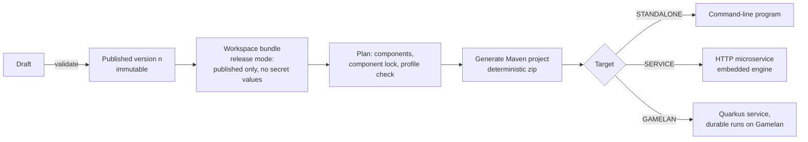
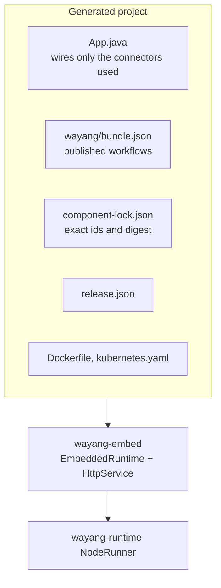
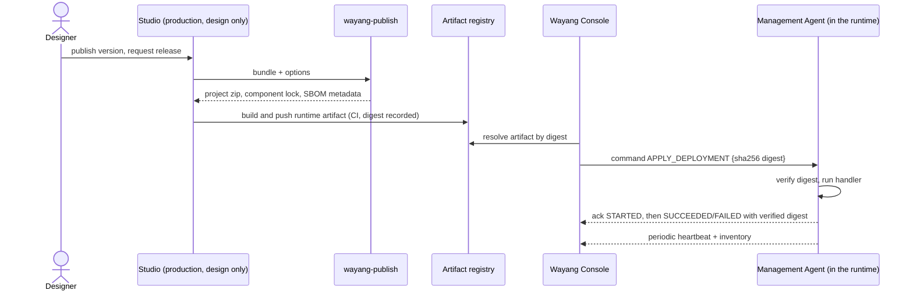
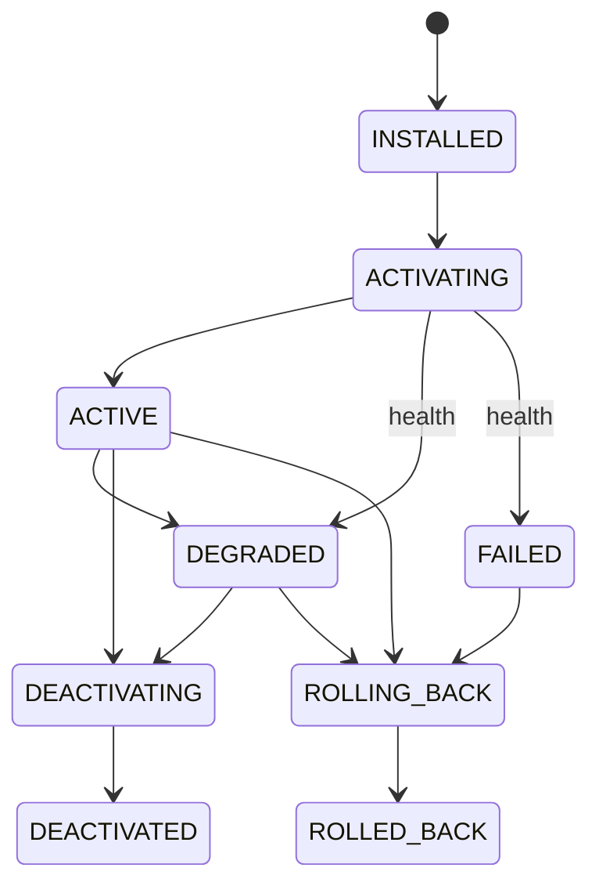

# 5. Release and operations

## Design phase to production

`POST /api/v1/projects/{id}/release/plan` previews; `POST .../release` returns the zip. Options: `target`, `groupId`, `artifactId`, `version`, `package`, `port`, `profile` (and `gamelanVersion`, `quarkusVersion` for GAMELAN). The same bundle and options give a byte-identical zip. A profile that cannot run a node in the bundle refuses the release up front. Full reference and verification status: [RELEASE](../RELEASE.md).

## What a generated runtime contains

HTTP surface of a SERVICE release: `/healthz`, `/readyz` (no auth), `/v1/release`, `/v1/processes/{id}/runs`, `/v1/runs`, `/v1/runs/{id}`, `/v1/runs/{id}/cancel`, `/v1/tasks/{token}/complete`, and `/v1/files` when file steps are used. Everything under `/v1` needs the API key; a release has a single tenant.

Secrets come only from the environment or mounted files (`WAYANG_SECRET_<NAME>`, `$WAYANG_SECRETS_DIR/NAME`); `check` lists missing ones; `doctor` lists risks. SERVICE and STANDALONE keep runs in memory (one replica); use GAMELAN for durable or long-running work.

## Agent runtime versus workflow runtime

| | Agent runtime | Workflow runtime |
|---|---|---|
| Built from | an agent definition (today wrapped in a workflow with an agent step) | BPMN, DMN, EIP or common workflow definitions |
| Profile | `agentic` | `automation`, `integration` or `full` |
| Serves | invoke/chat style runs, tools, memory, knowledge | start runs, tasks, messages, timers |
| Status | works as a release with an agent step; a dedicated generator is **proposed** | implemented |

## Sequence: release and rollout (Pro / Enterprise)

Implemented in this repository: bundle/release generation, the component lock, the deployment lifecycle ledger and receipts, the Management Agent client with handler-gated command polling and digest-verified acknowledgements. Not implemented here: the Console itself (separate repository); the registry hand-off is **proposed**. Management is off by default and opt-in (`wayang.management.enabled`); a runtime keeps executing without the Console. See [docs/architecture/](../architecture/) and [docs/deployment/](../deployment/).

## Deployment lifecycle

The states are the `DeploymentState` enum; transitions are allow-listed and anything else fails closed. A health result of UNKNOWN counts as failure, never readiness. The ledger is engine-neutral and audited (actor, reason, correlation id, idempotency key, expected version); operation receipts make activation idempotent across crashes ([lifecycle-ledger](../deployment/lifecycle-ledger.md), [operation-receipts](../deployment/operation-receipts.md)).

## Worker pools (Gamelan)

One worker image can run as several pools: each executor type (`service`, `agent`, `bpmn`, `dmn`, `eip`, `human`) is switched with `wayang.worker.<name>.enabled`. Every type must be on in at least one pool, or the nodes that need it wait. Not verified against a live Gamelan ([DEPLOYMENT](../DEPLOYMENT.md)).

## Operating checklist

- Secrets from the environment or a secret store, never in bundles. `WAYANG_REQUIRE_SECRETS=true` for production.
- An API key on every release; loopback-only without one.
- Connector allow-list (`WAYANG_CONNECTORS_ALLOWED_HOSTS`) instead of opening private networks.
- File storage directory (`WAYANG_FILES_DIR` or `WAYANG_STATE_DIR`) on a volume if knowledge or files must survive restarts; set retention (`WAYANG_FILES_MAX_TTL_DAYS`, `WAYANG_KNOWLEDGE_MAX_TTL_DAYS`).
- Schedule `file-purge` and a `rag-forget` with no ids to clear expired data.
- One replica for in-memory targets; Gamelan for durability.
