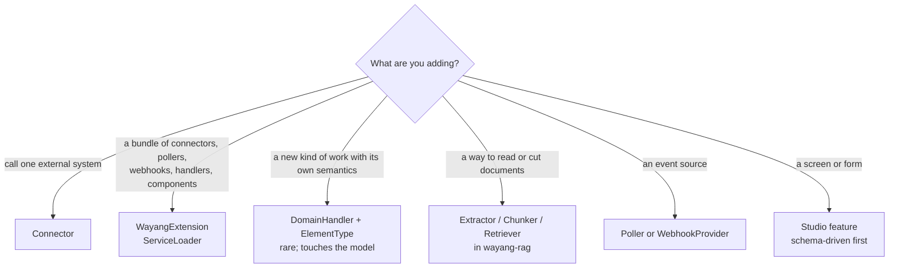
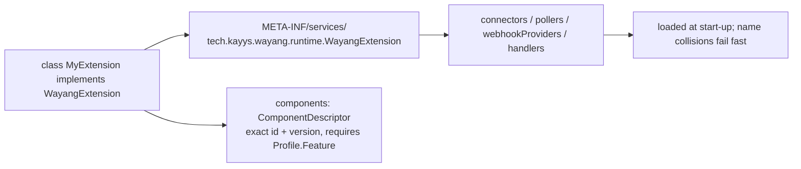
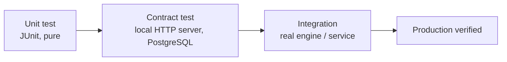

# 6. Developer guide

How to add to Wayang without breaking its rules. The rules first, then recipes. Repository rules are in [AGENTS.md](../../AGENTS.md); read it before a first change.

## Ground rules

1. Smallest coherent change; tests for behavior, security and failure paths; update the docs in the same change.
2. No new dependency or Maven module without a stated reason. Prefer JDK-only core modules. Java baseline 21.
3. Never put a second durable workflow engine, agent runtime, or Console server in this repository.
4. Secrets are `${secret:NAME}` references only; never log, echo in errors, or store a secret value. Bound every payload, count and time.
5. Retrieved, fetched or tool-returned text is untrusted data; never treat it as instructions.
6. Mark what you did not verify. A local compile or a stub test is not CI; say which one you ran.

## Choose the right extension point



Most work is a **connector inside an extension**. Reach for a new element type only when a connector cannot express the semantics (it is a change to the definition model, the compiler, Gamelan mapping, Studio and docs).

## Recipe: add a connector

A connector implements `ServiceHandler.Connector`:

```java
final class Greet implements ServiceHandler.Connector {
    @Override public boolean tenantScoped() { return false; }                       // true only if it keeps per-tenant state
    @Override public List<ConnectorInput> inputs() {                                // advisory: missing => warning, not failure
        return List.of(ConnectorInput.required("name", "string", "Who to greet"));
    }
    @Override public Map<String, Object> call(Map<String, Object> inputs) throws Exception {
        throw new ServiceHandler.ConnectorException("greet needs node configuration", false);
    }
    @Override public Map<String, Object> call(Map<String, Object> config, Map<String, Object> in) throws Exception {
        if (!(in.get("name") instanceof String n) || n.isBlank()) {                 // cope with a missing input: return empty, never throw
            return Map.of("greeting", "");
        }
        return Map.of("greeting", "Hello, " + n);
    }
}
```

Checklist:

- **Failures**: throw `ConnectorException(message, retryable)`: 503 is retryable, 404 is not. Messages must not contain secrets or raw remote bodies beyond a short snippet.
- **Network**: go through `MediaHttp`/`HttpConnector` with the `UrlGuard`; never open a socket yourself. Cap response size and time.
- **Config**: the node's static config arrives with secrets resolved. A key the user can set must be added to the closed schema in `NodeCatalog` (otherwise validation says "unknown property") and to the Studio inspector comes free from the schema.
- **Registration**: built-ins go in `Connectors.builtIn(...)` (`wayang-connectors`). Anything in an extension is registered through its `WayangExtension.connectors()`.
- **Releases**: a release only includes what a workflow uses. A connector from an optional module must be listed in `Publisher` (a `*_CONNECTORS` set and its dependency block) and in `ReleaseArtifactCatalog` so the generated project gets the right artifact.
- **Agent tool**: it works as a tool automatically (`type` = connector name); the author fixes `config`, the model supplies arguments. If it holds state, make it `tenantScoped()`.
- **Tests**: success, each failure class, missing input, secret not echoed, and (for HTTP) a local `com.sun.net.httpserver.HttpServer`, not the internet.

## Recipe: add an extension



`wayang-knowledge` is the reference: JDK-only, registers connectors, declares descriptors (with `requires()` = `KNOWLEDGE`), and takes its configuration from the environment. Names must not collide with built-ins or other extensions. Extensions are build-time inclusion or `ServiceLoader` on the classpath; do not claim hot loading.

## Recipe: add a node type (rare)

Touch, in order: `ElementType` (executor type, wait or not) -> loader/validator in `wayang-business-process` -> `ProcessCompiler` (plan fields) -> a `DomainHandler` in `wayang-runtime` -> executor mapping in `wayang-gamelan-worker` (`GamelanPlanMapper`, a new `@Executor`) and its worker-pool switch -> `Profile.Feature` and violations -> `NodeCatalog` schema -> Studio (palette comes from the catalog; canvas shape may need a widget) -> BPMN XML import/export if it has a BPMN meaning (otherwise reject explicitly) -> docs and conformance tests. If you cannot do every step, you are probably building a connector.

## Recipe: add a RAG capability (`wayang-rag`)

| You add | Implement | Register in | Notes |
|---|---|---|---|
| Format | `Extractor` | `Extractors` defaults (content sniffing for binary formats) | bound sizes; OCR is an explicit opt-in (`Ocr` SPI) |
| Chunker | `Chunker` | the chunking factory (`chunking.type`) | deterministic; keep chunk ids stable |
| Retrieval method | retrieval strategy | `RetrievalConfig` | scores must be comparable across methods before fusion |
| Embedder | `Embedder` | `KnowledgeRegistry.embedder(...)` | SSRF-guarded; never put the key in stored state |

Persisted shapes carry a format version; changing the stored layout needs a new version and a load path for the old one ([RAG](../RAG.md)). Add the option to the extension's descriptor schema and to `NodeCatalog`.

## Recipe: add a trigger source

Polling: implement `Poller` (stateless; take a cursor, return events and the next cursor; the caller persists it *after* hand-over, so delivery is at-least-once). Push: implement `WebhookProvider` and verify the provider's signature in constant time before parsing. Keep event payloads small and flat. Register through an extension.

## Recipe: add a Studio feature

Studio is one Flutter app (Riverpod): `lib/features/<feature>` for screens, `lib/providers` for state, `lib/models`, `lib/data` for the API client. Forms for node configuration are generated from `GET /catalog/nodes`, so most new fields need only a schema change. Add a screen only for new workflows. Authoring state is server-side (drafts with `If-Match`), never a local copy of validation. Flutter tooling is not part of the Java build; say whether you ran `flutter analyze` and tests.

## Testing and verification



- Prefer pure unit tests with a movable `Clock` and a local `HttpServer`.
- Test security paths on purpose: SSRF refusal, secret not echoed, tenant isolation, size caps, injection in names and headers, malformed and torn files.
- Run the narrowest module first (`mvn -pl <module> -am test`), then the full build. CI (java, studio, andalus, wayang-core-adapter) is the real check. If Maven or Flutter is unavailable, report exactly what you ran instead.
- Real JUnit is stricter than ad hoc runners: for example `assertEquals(18, longValue)` fails (Integer versus Long). Use matching types.
- Be explicit in PRs: **unit-tested**, **contract-tested**, **compiled only**, **not verified**.

## Documentation checklist

- A new public contract: update its document and any conformance fixtures.
- New config keys: `NodeCatalog`, the connector's descriptor, the doc that describes the connector.
- New connector in a release: `Publisher`, `ReleaseArtifactCatalog`, [RELEASE](../RELEASE.md).
- Planned versus implemented: label every unbuilt item **proposed**.
- Keep the root README short; put detail in a focused document and link it here.

## Where things live

| I want to find... | Look in |
|---|---|
| element types, compiler, plan | `wayang-business-process` |
| handlers, runner, waits, profiles, extension SPI | `wayang-runtime` |
| built-in connectors, SSRF guard, pollers | `wayang-connectors` |
| knowledge, files | `wayang-rag`, `wayang-rag-pdf`, `wayang-knowledge` |
| REST/WebSocket/gRPC, definitions, runs, secrets, projects | `wayang-api-core`, `wayang-api-rest` |
| release generation | `wayang-publish`, `wayang-embed` |
| Gamelan and Andalus adapters | `wayang-gamelan-worker`, `wayang-adapter-gamelan`, `wayang-adapter-andalus` |
| deployment ledger, Management Agent client | `wayang-deployment`, `wayang-management-client` |
| UI | `studio/` |
