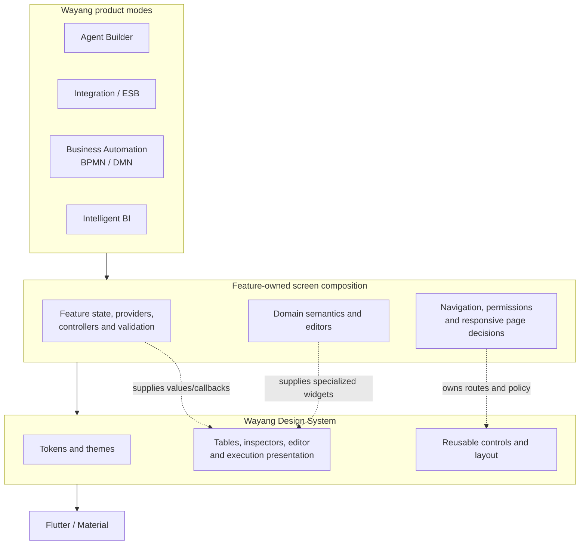
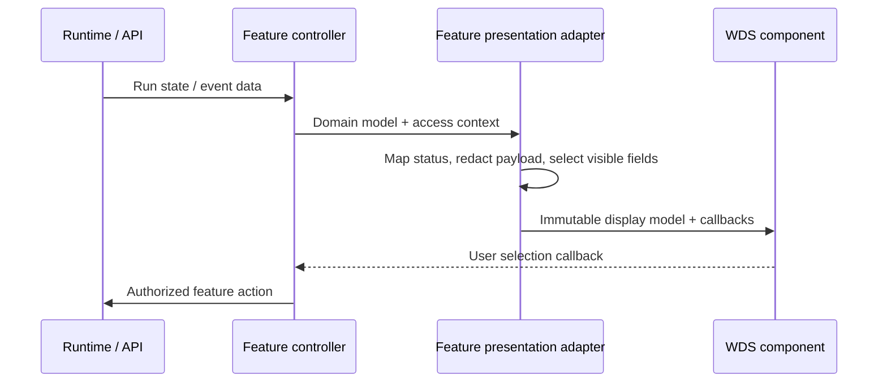

# Studio WDS Adoption Audit and Migration Roadmap

## Purpose

This document turns the WDS component catalog and legacy-widget inventory into
an actionable Studio-wide adoption program. The objective is not to replace
every Flutter widget with a WDS wrapper. It is to make shared visual patterns
consistent while keeping product-mode behavior, state and domain semantics in
the feature layer.

This is a planning and audit baseline. It does not claim that every Studio
screen or every call site has been exhaustively enumerated. The source-grounded
legacy API inventory is in `legacy-widget-migration.md`; the public WDS surface
is listed in `README.md`. A repository-wide call-site census must be recorded
as each migration wave begins.

## Current baseline

### Verified source surfaces

- `studio/lib/core/widgets.dart` contains the legacy shared widget APIs:
  `SurfacePanel`, `StatusPill`, `ScreenHeader`, `KpiCard`,
  `EmptyState`, `LoadingView`, `ErrorView`, `AppSearchField`,
  `KeyValueRow`, `PanelSectionLabel`, `showConfirmDialog`,
  `showToast` and `confirmDiscardEdits`.
- `studio/lib/design_system/wds.dart` is the public WDS export surface.
- `studio/design-system/README.md`, `legacy-widget-migration.md`,
  `accessibility-audit.md`, `showcase.md` and
  `examples/execution-views.md` define the current component contracts,
  accessibility baseline, showcase and mode-specific composition guidance.
- The legacy-widget migration PR and adapter-migration PR are separate changes.
  Do not assume proposed adapters are available in main until their PRs merge.
- The execution primitives and mode examples also have separate PR history.
  Check the merged public API before copying example snippets into production.

### Adoption principle

WDS is the shared visual vocabulary. A feature screen composes WDS components
with its own state, controllers, providers, domain-specific controls and
navigation. A mode may add specialized components locally without extending
WDS when the abstraction is not genuinely shared.

## Layering and ownership

**WDS may own:** visual tokens, reusable presentation, layout primitives,
semantic visual variants, accessible interaction mechanics, component-level
responsive behavior, and showcase examples.

**Feature/host must own:** API calls, repositories, Riverpod/provider state,
workflow and graph semantics, plugin/connector discovery, permission checks,
route registration, persistence, validation rules, execution subscriptions,
event ordering, retry/cancel behavior, and user confirmation decisions.

## Adoption matrix

The matrix below maps the existing shared WDS catalog to the screen families
that should consume it. It is a target mapping, not a claim that all listed
screens have already been migrated.

| Screen family | Shared WDS building blocks | Feature-owned behavior | Adoption priority |
|---|---|---|---|
| Studio shell and navigation | Navigation rail / compact bar, buttons, badges, surfaces | Route table, selected destination, permissions, plugin-provided destinations | P0 |
| Catalogs and resource lists | Page header, search, filter toolbar, data table, empty state, badges | Query/filter state, paging, sorting algorithm, row actions, resource loading | P0 |
| Resource detail and inspector | Breadcrumbs, page header, inspector sections, field groups, property rows, field messages | Domain field definitions, validation, persistence, secret handling | P0 |
| Agent Builder canvas | Editor toolbar/panel, node card/ports, buttons, badges | Graph model, connection rules, node configuration, selection, drag/drop, undo/redo | P1 |
| Agent configuration / tool catalog | Page header, filter toolbar, data table, inspector, empty state | Agent/tool schemas, marketplace trust, permissions, installation and versioning | P1 |
| Integration / ESB designer | Editor toolbar/panel, node/port visuals, inspector, status indicator | EIP patterns, endpoint schemas, route validation, connector lifecycle | P1 |
| BPMN / DMN designers | Editor panel/toolbar, node/port visuals where appropriate, inspector | BPMN/DMN notation, model constraints, simulation, deployment semantics | P1 |
| Run / process monitoring | Execution status, timeline, event list, property rows, data table | Runtime lifecycle mapping, trace stitching, event stream, redaction, access control | P1 |
| Intelligent BI dashboards | Page header, surfaces, data table, KPI/metric presentation if justified, filter toolbar | Query plans, chart specs, lineage, quality rules, refresh and authorization | P2 |
| Settings and administration | Page header, inspector fields, data table, buttons, field messages | Identity, tenant policy, secrets, integrations and configuration workflows | P2 |

### Priority definitions

- **P0 — foundational adoption:** shell, navigation, list/catalog and inspector
  patterns. These have the broadest reuse and establish consistent page
  structure before deeper editor work.
- **P1 — specialized authoring and operations:** node-based editors and
  execution monitoring. These need careful separation between generic
  presentation and product-mode semantics.
- **P2 — cross-mode polish:** dashboard and administration patterns after the
  shared contracts and responsive behavior have stabilized.

## Migration waves

### Wave 0 — establish an accurate census

Before changing a screen family:

1. Search all imports and usages of `core/widgets.dart` and the WDS public
   entry point.
2. Record each call site by file, widget/API, screen family and current
   behavior.
3. Record whether the component is direct WDS, a compatibility facade, a
   candidate for migration, or intentionally feature-owned.
4. Capture a representative screenshot or widget test for non-trivial layouts.
5. Identify existing tests and note missing interaction/semantics coverage.

Deliverable: a checked-in call-site inventory with file paths and counts. Do
not infer call-site counts from the legacy API definitions alone.

### Wave 1 — shell and shared page chrome (P0)

- Audit navigation rail and compact navigation at phone, tablet and desktop
  constraints.
- Migrate page titles, breadcrumbs, common actions and search/filter rows to
  page composition primitives.
- Keep route selection, authorization and command execution in the host.
- Preserve compatibility imports until all consumers are migrated.
- Add representative widget tests for narrow/wide layouts, keyboard focus,
  selected navigation semantics and large text.

Exit gate: no duplicate page-header/navigation implementation remains without
a documented reason; route behavior and selected state are unchanged.

### Wave 2 — catalogs, tables and inspectors (P0)

- Migrate one catalog family at a time to the shared header/filter/table/empty
  state pattern.
- Standardize table column alignment, row density, selection affordances,
  loading and empty-state presentation.
- Standardize inspector sections, field groups, property rows and inline field
  messages.
- Keep query state, pagination, sort algorithms, validation and persistence
  outside WDS.
- Test selection callbacks, sort callbacks, empty/loading states, narrow
  layouts and keyboard interaction.

Exit gate: catalog screens have consistent composition, and host-owned
filtering/paging/validation behavior is unchanged.

### Wave 3 — node-based authoring (P1)

- Adopt editor toolbar and panel patterns in Agent Builder first.
- Use generic node card and port visuals only as a rendering layer.
- Map node statuses and port kinds in feature adapters; do not put agent,
  BPMN, DMN or ESB semantics in WDS.
- Audit canvas scaling, hit targets, focus/keyboard alternatives and selection
  contrast.
- Keep graph topology, connection validation, drag/drop, undo/redo and
  persistence in the editor feature.

Exit gate: visual primitives are shared, while each editor remains free to
implement its own graph/model contract.

### Wave 4 — run and process monitoring (P1)

- Compose shared status indicators, timelines, event lists and property rows
  into feature-owned run inspectors.
- Verify Agent Builder, ESB, BPMN/DMN and BI examples against the merged WDS
  API before adopting snippets.
- Redact sensitive payloads before values reach WDS.
- Keep event ingestion, ordering, filtering, pagination, retention, retries,
  trace stitching and authorization outside WDS.
- Test long event descriptions, empty timelines, large event volume paging
  owned by host, and responsive inspector layouts.

Exit gate: shared monitoring visuals are consistent without creating a
cross-mode runtime event model inside WDS.

### Wave 5 — BI, dashboards and administration (P2)

- Reuse generic page, table, inspector and surface components.
- Introduce a neutral metric/card primitive only if at least two distinct
  feature areas demonstrate the same stable presentation contract.
- Keep chart rendering, query execution, lineage, data quality and refresh
  policy in BI.
- Keep tenant, identity, secret and integration policy in administration
  features.

Exit gate: no BI or admin domain dependency is added to WDS.

### Wave 6 — compatibility cleanup

- Re-run repository-wide searches for each legacy API.
- Remove a facade only when there are no remaining in-repository consumers and
  any supported downstream API impact is understood.
- Remove one compatibility API per focused change, with migration notes.
- Keep app-level dialogs, toasts, loading/error flows and unsaved-edit
  decisions outside WDS unless a future, separately reviewed presentation-only
  API is defined.

Exit gate: deletion is evidence-driven, not part of a broad visual refactor.

## Component-to-feature adapter pattern

A feature adapter translates domain data into neutral WDS display data. It
must not move domain rules into the component.

For example, an Agent Builder adapter may map a tool invocation to an execution
step. An ESB adapter may map a connector hop to a timeline row. WDS sees only
the resulting title, status, description and display metadata; it does not
know what a tool invocation or connector hop means.

## Quality gates for every migration

### Visual and responsive

- Light and dark themes use semantic color roles.
- No new hard-coded palette values where a theme token exists.
- Test compact phone, tablet, standard desktop and wide editor constraints.
- Verify text scaling, overflow, wrapping and scroll ownership.
- Avoid fixed-height text regions unless the contract explicitly requires it.

### Accessibility

- Meaningful semantics for icon-only controls.
- Selected, disabled, expanded and busy states are exposed where applicable.
- Keyboard navigation and activation are available for actionable controls.
- Focus remains visible and is not clipped by panels or overlays.
- Contrast is reviewed for normal, selected, disabled and status states.
- Touch targets are comfortable; dense exceptions are deliberate.

### API and architecture

- WDS APIs accept values, slots and callbacks; they do not fetch or persist.
- No Riverpod, router, API client, workflow engine or plugin SDK dependency in
  WDS.
- Controlled components remain controlled; no hidden duplicate state.
- Public exports are deliberate and documented.
- Compatibility wrappers remain until call-site evidence supports removal.

### Tests and CI

- Unit tests for pure mapping/formatting helpers.
- Widget tests for rendering, callbacks, semantics, themes and empty/loading
  states.
- Golden tests only for stable, high-value shared patterns; avoid brittle
  snapshots of rapidly changing feature screens.
- Run `flutter analyze` and the relevant `flutter test` suite from
  `studio/` in CI before merge.
- Record test execution honestly; authored tests are not equivalent to passed
  tests.

## Proposed inventory record

Use one row per call-site family (or per file when behavior differs):

| Field | Meaning |
|---|---|
| File / symbol | Exact source path and widget/API |
| Screen family | Shell, catalog, inspector, editor, monitoring, BI, admin |
| Current contract | Layout, state, callbacks, loading/error and keyboard behavior |
| WDS target | Exact public component or `none` with reason |
| Adapter needed | Domain-to-display mapping required |
| Ownership notes | State, navigation, validation, permissions and data owner |
| Accessibility gaps | Semantics, focus, contrast, text scaling, target size |
| Tests | Existing and required widget/unit tests |
| Status | Not audited, audited, in progress, migrated, intentionally local |

## Immediate next implementation sequence

1. Verify and reconcile the WDS-related PRs against current main; resolve CI
   failures before treating those APIs as stable.
2. Produce the actual source-wide call-site census (Wave 0).
3. Complete P0 shell/navigation adoption with tests.
4. Complete P0 catalogs and inspector adoption.
5. Move to Agent Builder editor primitives, then other modes.
6. Finish with monitoring, BI/admin and compatibility cleanup.

This order reduces churn: shared page patterns stabilize before feature screens
adopt them, and the most domain-sensitive editors are migrated only after the
host/WDS boundary is well tested.
